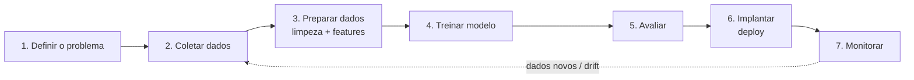

## Resumo

Machine Learning, ou Aprendizado de Máquina, é um **subcampo da [[01 - O que é Inteligência Artificial|Inteligência Artificial]]**. Em vez de programadores escreverem regras detalhadas linha por linha dizendo ao computador exatamente o que fazer, nós fornecemos grandes quantidades de **dados** ao sistema e deixamos que ele **"aprenda" os padrões** por conta própria.

Os algoritmos de ML melhoram seu desempenho gradativamente: quanto mais dados e "experiência" adquirem, mais precisos se tornam em suas previsões ou classificações.

> [!info] Ideia central
> - **Programação tradicional:** Regras + Dados → Resposta
> - **Machine Learning:** Dados + Respostas → **Regras** (o modelo)

## Conceitos-Chave

| Termo | Significado |
|---|---|
| **Dataset** | O conjunto de dados usado para treinar |
| **Feature (característica)** | Uma variável de entrada (ex.: área do imóvel, nº de quartos) |
| **Label (rótulo)** | A resposta que queremos prever (ex.: preço do imóvel) |
| **Modelo** | O "cérebro" resultante do treino — a função aprendida |
| **Treinamento** | Processo em que o algoritmo ajusta o modelo usando os dados |
| **Inferência** | Usar o modelo treinado para prever dados **novos** |
| **Overfitting** | O modelo "decorou" o treino e vai mal em dados novos |
| **Underfitting** | O modelo é simples demais e não aprendeu nem o treino |

## Tipos de Aprendizado

Detalhados na pasta [[08 - Tipos de Algoritmos de Machine Learning|ML]]:
- **[[04 - Aprendizado Supervisionado|Supervisionado]]** → aprende com **dados rotulados** (tem gabarito). Ex.: prever preço, detectar spam.
- **[[05 - Aprendizado Não Supervisionado|Não Supervisionado]]** → encontra **padrões** em dados sem rótulo. Ex.: segmentar clientes.
- **[[06 - Aprendizado por Reforço|Por Reforço]]** → aprende por **tentativa e erro** com recompensas. Ex.: AWS DeepRacer.

## Ciclo de Vida de um Projeto de ML

## Quando Usar (e Quando Não Usar) ML

| ✅ Use ML quando... | ❌ Evite ML quando... |
|---|---|
| As regras são **complexas demais** para escrever à mão | Uma regra simples resolve ("se saldo < 0, bloqueie") |
| Existe **muito dado histórico** disponível | Não há dados suficientes ou de qualidade |
| O padrão **muda com o tempo** (fraudes, preferências) | É preciso uma resposta **100% exata e explicável** (ex.: cálculo de imposto) |

## Exemplo para Associação Mental

**A Criança e o Livro de Figuras** Imagine que você quer ensinar um computador a reconhecer o que é uma "maçã".

- **Sem Machine Learning (Programação Tradicional):** Você teria que escrever um código dizendo: "Se o objeto for redondo, vermelho ou verde, e tiver um cabinho em cima, é uma maçã". (Isso falharia se a foto estivesse cortada ou a maçã fosse amarela.)
- **Com Machine Learning:** Você age como quem ensina uma criança. Mostra ao computador 10.000 fotos de maçãs e diz: "Isto é uma maçã". Depois, mostra 10.000 fotos de laranjas e diz: "Isto não é uma maçã". O próprio computador cria suas regras internas para identificar os padrões visuais da fruta.

No dia a dia, o ML é o que faz o **filtro de Spam do seu e-mail** funcionar. Ele aprendeu que palavras como "Loteria", "Você ganhou" e "Clique aqui" geralmente significam lixo eletrônico, baseando-se em milhões de e-mails marcados pelos usuários. Também está por trás da **recomendação da Netflix** e da **previsão de fraude** no cartão de crédito.

## Na AWS (AI Practitioner)

- **Amazon SageMaker** → plataforma completa para preparar dados, treinar, implantar e monitorar modelos.
  - **SageMaker Canvas** → ML **sem código** (no-code) para analistas.
  - **SageMaker Autopilot** → AutoML: testa algoritmos automaticamente.
  - **SageMaker Ground Truth** → rotulagem de dados.
  - **SageMaker Model Monitor** → detecta queda de qualidade (*drift*) em produção.

---
Nível anterior: [[01 - O que é Inteligência Artificial|IA]] · Próximo nível: [[09 - O que é Deep Learning|Deep Learning]] · 🗺️ [[00 - Níveis de IA.canvas|Níveis de IA]]
