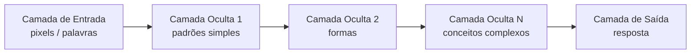

## Resumo

O Deep Learning (Aprendizado Profundo) é um **subcampo específico do [[02 - O que é Machine Learning|Machine Learning]]**. O que o torna "profundo" (*deep*) é o uso de **Redes Neurais Artificiais** com **muitas camadas** de processamento, vagamente inspiradas no funcionamento do cérebro humano.

Enquanto o Machine Learning tradicional muitas vezes precisa de ajuda humana para estruturar os dados e apontar quais características analisar (*feature engineering*), o Deep Learning consegue processar **dados "crus" e não estruturados** — pixels de uma imagem, ondas sonoras, texto livre — e **descobrir sozinho** as características importantes.

> [!info] Ideia central
> **Deep Learning = Machine Learning com redes neurais de muitas camadas**, capaz de aprender direto de dados brutos (imagem, áudio, texto).

## Como Funciona uma Rede Neural

- **Neurônio:** unidade que recebe números, aplica um **peso**, soma e passa adiante.
- **Pesos:** os "botões de ajuste" que a rede aprende durante o treino (modelos grandes têm **bilhões** deles — os famosos "parâmetros").
- **Camadas ocultas:** quanto mais camadas, mais "profunda" a rede e mais complexos os padrões que ela capta.

## Principais Arquiteturas

| Arquitetura                             | Especialidade                                       | Exemplo                                                                         |     |
| --------------------------------------- | --------------------------------------------------- | ------------------------------------------------------------------------------- | --- |
| **CNN** (Rede Neural Convolucional)     | **Imagens** e vídeo                                 | Face ID, diagnóstico por raio-X                                                 |     |
| **RNN / LSTM** (Rede Neural Recorrente) | **Sequências** (texto, séries temporais)            | Previsão de ações, teclado preditivo antigo                                     |     |
| **Transformer**                         | **Linguagem** e muito mais (mecanismo de *atenção*) | Base do ChatGPT, Claude, tradutores modernos                                    |     |
| **GAN / Modelos de Difusão**            | **Gerar** imagens                                   | Base de geradores de imagem (ver [[10 - O que é IA Generativa\|IA Generativa]]) |     |

## ML Tradicional × Deep Learning

| Critério               | ML Tradicional           | Deep Learning                          |
| ---------------------- | ------------------------ | -------------------------------------- |
| **Tipo de dado**       | Estruturado (tabelas)    | Não estruturado (imagem, áudio, texto) |
| **Features**           | Definidas por humanos    | Aprendidas automaticamente             |
| **Volume de dados**    | Funciona com menos dados | Precisa de **muitos** dados            |
| **Hardware**           | CPU comum                | **GPU** (processamento paralelo)       |
| **Interpretabilidade** | Mais fácil de explicar   | "Caixa-preta", difícil de explicar     |
| **Custo de treino**    | Baixo / médio            | Alto                                   |

## Exemplo para Associação Mental

**A Linha de Montagem de Especialistas** Imagine que você precisa identificar se há um cachorro em uma foto.

- No **Machine Learning tradicional**, um humano teria que ensinar ao sistema: "procure por duas orelhas pontudas, um focinho e uma cauda".
- No **Deep Learning**, o processo funciona como uma linha de montagem com vários inspetores (as "camadas" da rede neural):
    - O inspetor da _primeira camada_ só olha para linhas e bordas na foto.
    - O inspetor da _segunda camada_ junta essas linhas e percebe formas circulares ou triangulares.
    - O inspetor da _terceira camada_ junta as formas e reconhece um focinho ou uma orelha.
    - O inspetor da _última camada_ junta tudo e conclui com alta precisão: "Isso é um cachorro da raça Golden Retriever".

No dia a dia, o Deep Learning é o que faz o **Face ID do seu celular** reconhecer o seu rosto mesmo de óculos ou com um corte de cabelo diferente. Também é essencial para os **carros autônomos**, que processam imagens das câmeras em tempo real para diferenciar um poste de um pedestre, e para a **transcrição de áudio** do WhatsApp.

## Na AWS (AI Practitioner)

- **Amazon Rekognition** → visão computacional pronta (rostos, objetos, moderação de conteúdo).
- **Amazon Transcribe / Polly** → voz → texto e texto → voz.
- **Amazon Textract** → extrai texto e tabelas de documentos escaneados.
- **Instâncias EC2 com GPU** e chips **AWS Trainium** (treino) / **AWS Inferentia** (inferência) → hardware para Deep Learning.

---
Nível anterior: [[02 - O que é Machine Learning|Machine Learning]] · Próximo nível: [[10 - O que é IA Generativa|IA Generativa]] · 🗺️ [[00 - Níveis de IA.canvas|Níveis de IA]]
