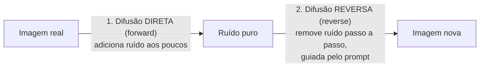

## Resumo

A IA Generativa (GenAI) é o braço mais moderno dentro do [[02 - O que é Machine Learning|Machine Learning]], construída sobre o [[09 - O que é Deep Learning|Deep Learning]]. Enquanto a IA tradicional costuma **analisar** dados para prever, classificar ou decidir (ex.: "vai chover amanhã?"), a **IA Generativa usa o que aprendeu para CRIAR conteúdo novo e original**: textos, imagens, áudios, vídeos e código.

Ela é treinada com um volume colossal de dados (textos, imagens, códigos da internet) e, ao aprender **a probabilidade de como esses elementos se conectam**, consegue gerar conteúdos inéditos que parecem ter sido feitos por um ser humano.

> [!info] Ideia central
> **IA tradicional → ANALISA** ("isso é spam?")
> **IA Generativa → CRIA** ("escreva um e-mail de resposta")

## Conceitos-Chave

| Termo                                     | Significado                                                                                     |
| ----------------------------------------- | ----------------------------------------------------------------------------------------------- |
| **Foundation Model (Modelo de Fundação)** | Modelo gigante pré-treinado com dados amplos, que serve de **base para várias tarefas**         |
| **LLM (Large Language Model)**            | Foundation Model especializado em **linguagem** (ChatGPT, Claude, Llama, Amazon Nova)           |
| **Prompt**                                | A instrução / pergunta que você dá ao modelo                                                    |
| **Token**                                 | "Pedaço" de texto (≈ ¾ de uma palavra) — unidade que o modelo lê, gera e pela qual se **cobra** |
| **Janela de contexto**                    | Quantos tokens o modelo consegue "lembrar" de uma vez                                           |
| **Temperatura**                           | Controla a criatividade: baixa = previsível; alta = criativa/aleatória                          |
| **Alucinação**                            | Quando o modelo inventa uma resposta falsa com total confiança                                  |
| **Multimodal**                            | Modelo que entende/gera **vários tipos** de mídia (texto + imagem + áudio)                      |

## Como Adaptar um Modelo ao Seu Negócio

Do mais simples/barato para o mais complexo/caro:

1. **Prompt Engineering** → escrever instruções melhores (exemplos, papel, formato). Sem treino.
2. **RAG (Retrieval-Augmented Generation)** → o modelo **consulta seus documentos** antes de responder. Reduz alucinações e usa dados atualizados.
3. **Fine-tuning (Ajuste fino)** → treina o modelo um pouco mais com **seus dados** para mudar seu estilo ou especializá-lo.
4. **Pré-treino contínuo / do zero** → caríssimo; raramente necessário.

## Tipos de Conteúdo Gerado

| Tipo | Exemplos de ferramentas |
|---|---|
| **Texto e conversa** | ChatGPT, Claude, Gemini |
| **Código** | GitHub Copilot, Claude Code, Amazon Q Developer |
| **Imagem** | Midjourney, DALL-E, Stable Diffusion, Amazon Nova Canvas |
| **Áudio / Música / Voz** | ElevenLabs, Suno |
| **Vídeo** | Sora, Runway, Amazon Nova Reel |

## Arquiteturas de modelos generativos

| Arquitetura | Como gera | Uso típico | Na AWS |
|---|---|---|---|
| **Transformer (LLM)** | **Autorregressivo**: prevê o **próximo token**, um de cada vez | Texto, código, chat | Claude, Llama, **Nova** no Bedrock |
| **Modelo de difusão** | Aprende a **remover ruído** passo a passo | **Imagem** e vídeo | Stable Diffusion, **Nova Canvas / Reel** |
| **GAN** (*Generative Adversarial Network*) | Duas redes competem: **gerador** cria, **discriminador** julga se é real | Imagens sintéticas, *deepfakes* | Pouco usada nos serviços atuais |
| **VAE** (*Variational Autoencoder*) | Comprime em um **espaço latente** e reconstrói com variações | Imagens, dados sintéticos | — |

### As duas etapas do modelo de difusão (cai na prova)

1. **Difusão direta (*forward diffusion*)**: no **treino**, o modelo pega imagens reais e vai **adicionando ruído** até virar estática pura. Assim ele aprende como o ruído "estraga" a imagem.
2. **Difusão reversa (*reverse diffusion*)**: na **geração**, ele parte de **ruído aleatório** e vai **removendo o ruído** em vários passos, guiado pelo texto do prompt, até formar uma imagem nova.

> [!warning] Pegadinha
> **Geração autorregressiva de tokens** é como os **LLMs** funcionam, não os modelos de difusão. **Tokenização** e **aumento de dados** também não são etapas da difusão.

## Riscos e Cuidados (IA Responsável)

- **Alucinações** → respostas falsas convincentes.
- **Viés** → reproduz preconceitos presentes nos dados de treino.
- **Propriedade intelectual** → dúvidas sobre direitos autorais do conteúdo gerado.
- **Privacidade** → risco de vazar dados sensíveis enviados no prompt.
- **Uso malicioso** → deepfakes, desinformação, phishing.

## Exemplo para Associação Mental

**O Artista/Escritor que leu o mundo todo** Imagine uma pessoa extremamente talentosa que leu todos os livros de uma biblioteca gigantesca e viu todas as pinturas de todos os museus do mundo. Se você pedir: _"Escreva um poema sobre um astronauta descobrindo um planeta de pudim, no estilo de Machado de Assis"_, ela consegue criar isso do zero, combinando o conhecimento que absorveu de forma original.

É exatamente isso que ferramentas como o **ChatGPT** e o **Claude** (textos, resumos, código) e o **Midjourney / DALL-E** (imagens a partir de descrições) fazem. Elas não estão copiando e colando da internet; estão **gerando** algo novo, palavra por palavra (ou pixel por pixel), com base nos padrões que aprenderam.

## Na AWS (AI Practitioner)

- **Amazon Bedrock** → acesso via API a vários Foundation Models (Anthropic Claude, Meta Llama, Amazon Nova, Mistral...) **sem gerenciar servidores**. Inclui **Knowledge Bases** (RAG), **Agents** e **Guardrails** (filtros de segurança).
- **Amazon Q** → assistente de IA generativa pronto: **Q Business** (dados da empresa) e **Q Developer** (programação).
- **Amazon SageMaker JumpStart** → modelos pré-treinados para implantar e fazer fine-tuning.
- **PartyRock** → playground gratuito para experimentar apps de GenAI com Bedrock.

---
Nível anterior: [[09 - O que é Deep Learning|Deep Learning]] · Visão geral: [[11 - Comparação Geral e Casos de Uso|Comparação Geral e Casos de Uso]] · 🗺️ [[00 - Níveis de IA.canvas|Níveis de IA]]
