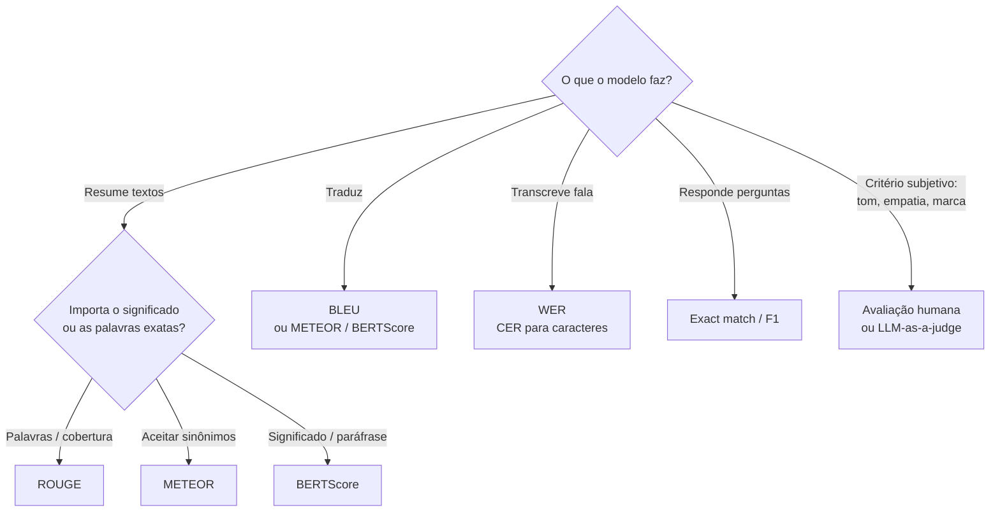

## Resumo

Como medir a qualidade de um modelo que **gera texto**: **resumos** (ROUGE, METEOR, BERTScore), **traduções** (BLEU) e **transcrições de fala** (WER, CER). Cai no **Domínio 3, Tarefa 3.4** (avaliar foundation models) e aparece em questões de Bedrock Evaluations, SageMaker Clarify/FMEval e Amazon Transcribe.

> [!info] Ideia central
> Quase todas comparam a **saída do modelo** com uma **referência humana** (o "gabarito").
> - **ROUGE** → **Resumo** (o resumo **cobriu** o que importava? = *recall*)
> - **BLEU** → **Tradução** ("**B**ilíngue"; o que foi gerado está **certo**? = *precisão*)
> - **METEOR** → como o BLEU/ROUGE, mas aceita **sinônimos e variações** da palavra
> - **BERTScore** → **significado** (compara **embeddings**, não palavras)
> - **WER** → **transcrição** (% de **palavras erradas**; **quanto menor, melhor**)

---

## 1. Tabela geral

| Métrica | Mede | Usada para | Como compara | Escala | Melhor |
|---|---|---|---|---|---|
| **ROUGE-N** | Sobreposição de **n-gramas** (sequências de N palavras) | **Resumo** | Palavras **exatas** | 0 a 1 | ⬆️ maior |
| **ROUGE-L** | Maior **subsequência comum** (ordem das palavras) | **Resumo** | Palavras exatas, considerando a ordem | 0 a 1 | ⬆️ maior |
| **BLEU** | **Precisão** de n-gramas + penalidade se a saída for **curta demais** | **Tradução** | Palavras exatas | 0 a 1 (ou 0–100) | ⬆️ maior |
| **METEOR** | Correspondência de palavras com **sinônimos, radicais** (*stemming*) e ordem | Tradução e **resumo** | Palavras **e variações** | 0 a 1 | ⬆️ maior |
| **BERTScore** | **Similaridade semântica** entre embeddings de cada palavra | Resumo, tradução, geração | **Significado** | ~0 a 1 | ⬆️ maior |
| **WER** (*Word Error Rate*) | % de palavras **substituídas, apagadas ou inseridas** | **Transcrição de fala** (ASR) | Palavras exatas, alinhadas | 0% a 100%+ | ⬇️ **menor** |
| **CER** (*Character Error Rate*) | Igual à WER, mas por **caractere** | Transcrição, OCR, idiomas sem espaços | Caracteres | 0% a 100%+ | ⬇️ **menor** |
| **Perplexidade** | Quão "surpreso" o modelo fica com o texto | Qualidade do **modelo de linguagem** | Probabilidades (sem referência) | ≥ 1 | ⬇️ **menor** |
| **Exact match / F1 over words** | Resposta igual ao gabarito / sobreposição de palavras | **Perguntas e respostas** | Palavras exatas | 0 a 1 | ⬆️ maior |

> [!warning] Cuidado com a direção
> **WER, CER e perplexidade: quanto MENOR, melhor** (são **erro** ou "surpresa"). Todas as outras: **quanto MAIOR, melhor**.

---

## 2. Métricas de resumo

### ROUGE (*Recall-Oriented Understudy for Gisting Evaluation*)
- O nome já diz: **orientada a recall**. Pergunta: "**das palavras do resumo de referência, quantas apareceram no resumo do modelo?**" Ou seja, o resumo **cobriu** o conteúdo importante?
- **ROUGE-1**: palavras soltas · **ROUGE-2**: pares de palavras · **ROUGE-N**: sequências de N palavras · **ROUGE-L**: maior sequência em comum na **mesma ordem** (estrutura da frase).
- Limitação: só conta **palavras iguais**. "Carro" e "automóvel" contam como erro.

### METEOR
- Criada para corrigir o BLEU: combina **precisão e recall** (dá mais peso ao recall) e aceita **sinônimos** e **variações** ("correu" ≈ "correr"), além de penalizar ordem bagunçada.
- Fica **entre** as métricas de palavras exatas (ROUGE/BLEU) e as semânticas (BERTScore).

### BERTScore
- Transforma cada palavra do texto gerado e da referência em **embeddings contextuais** (modelo tipo BERT/RoBERTa) e compara por **similaridade de cosseno**. Devolve precisão, recall e F1.
- Entende **paráfrases**: "o lucro caiu" ≈ "a empresa ganhou menos dinheiro".
- É mais **cara** de calcular (precisa de um modelo) e depende do modelo de embeddings usado.

### Exemplo: ROUGE x BLEU no mesmo resumo

**Referência (humano):** *"o gato sentou no tapete"* (5 palavras)
**Modelo:** *"o gato no tapete"* (4 palavras)

Palavras em comum: **o, gato, no, tapete** = 4

| Métrica | Conta | Resultado | Leitura |
|---|---|---|---|
| **ROUGE-1** (recall) | 4 em comum ÷ **5 da referência** | **0,80** | Faltou cobrir "sentou" |
| Precisão de unigramas (base do BLEU) | 4 em comum ÷ **4 do modelo** | **1,00** | Tudo o que o modelo disse está certo... |
| **BLEU** | precisão × **penalidade por ser curto** | **< 1,00** | ...mas ficou curto demais, então é penalizado |

> Se o modelo escrevesse *"o felino sentou no tapete"*, ROUGE e BLEU cairiam ("felino" ≠ "gato"), **METEOR** perdoaria parcialmente (sinônimo) e o **BERTScore** ficaria **alto** (mesmo significado).

---

## 3. Métrica de tradução: BLEU

**BLEU** (*Bilingual Evaluation Understudy*) é **orientada a precisão**: "**das palavras que o modelo gerou, quantas estão na tradução de referência?**" Usa n-gramas de 1 a 4 e aplica uma **penalidade de brevidade** para que o modelo não "trapaceie" gerando frases curtíssimas e seguras.

| | **ROUGE** | **BLEU** |
|---|---|---|
| Foco | **Recall**: cobriu tudo da referência? | **Precisão**: o que gerou está correto? |
| Tarefa clássica | **Resumo** | **Tradução** |
| Pune | Resumo que **esquece** informação | Tradução com palavras **erradas/inventadas** ou **curta demais** |
| Mnemônico | **R**OUGE = **R**esumo = **R**ecall | **B**LEU = **B**ilíngue |

---

## 4. Métricas de transcrição: WER e CER

### WER (*Word Error Rate*, taxa de erro de palavras)

Compara a **transcrição automática** com a **transcrição humana** (referência), alinhando as duas, e conta 3 tipos de erro:

$$\text{WER} = \frac{S + D + I}{N}$$

| Letra | Erro | Exemplo |
|---|---|---|
| **S** | **Substituição**: trocou uma palavra | "cancelar" → "comprar" |
| **D** | **Deleção**: palavra falada que **sumiu** | "hoje" não apareceu |
| **I** | **Inserção**: palavra que **não foi falada** apareceu | apareceu um "o" a mais |
| **N** | Nº de palavras da **referência** | — |

**Exemplo**

- **Falado (referência):** *"eu quero cancelar meu plano hoje"* → N = 6
- **Transcrito:** *"eu quero comprar o meu plano"*

| Referência | eu | quero | cancelar | — | meu | plano | hoje |
|---|---|---|---|---|---|---|---|
| Transcrição | eu | quero | comprar | o | meu | plano | — |
| Erro | ✅ | ✅ | **S** | **I** | ✅ | ✅ | **D** |

**WER = (1 + 1 + 1) ÷ 6 = 50%** → acurácia de palavras ≈ 1 − WER = 50%.

> [!note] Pontos que caem
> - **Menor é melhor**. WER de 5% = 95% das palavras corretas.
> - Pode passar de **100%** se houver muitas **inserções**.
> - Trata todos os erros igual: trocar "cancelar" por "comprar" (muda o sentido!) pesa o mesmo que um erro bobo. Por isso, em casos críticos, também se faz **avaliação humana**.
> - A AWS usa WER (junto com precisão, recall e F1 de palavras) para descrever a qualidade do **Amazon Transcribe** no seu **AI Service Card**. Para **melhorar** a WER no Transcribe: **vocabulário personalizado** e **modelo de linguagem personalizado** → [[04 - Amazon Transcribe|Amazon Transcribe]].

### CER (*Character Error Rate*)
Mesma fórmula, contando **caracteres**. Útil para idiomas **sem espaços** entre palavras (japonês, chinês), nomes próprios, códigos e **OCR** (Textract).

---

## 5. Onde essas métricas aparecem na AWS

| Ferramenta | Tarefa | Métricas |
|---|---|---|
| **Amazon Bedrock Evaluations** (automática) | **Resumo** | Acurácia = **BERTScore** · Robustez = BERTScore e **deltaBERTScore** · Toxicidade |
| | Perguntas e respostas | F1 e correspondência exata · robustez · toxicidade |
| | Classificação | Acurácia · robustez |
| **SageMaker Clarify / fmeval** | **Resumo** | **ROUGE-N, METEOR, BERTScore** · toxicidade · robustez semântica |
| | Perguntas e respostas | Exact match, quasi-exact match, **F1 over words** |
| | Classificação | Acurácia, precisão, recall, acurácia balanceada |
| **Amazon Transcribe** | Fala → texto | **WER** (e precisão/recall/F1 de palavras) |

**Robustez semântica** = quanto a métrica **cai** quando a entrada recebe pequenas alterações sem mudar o sentido (erros de digitação, maiúsculas, espaços). Quanto **menor a queda**, mais robusto.

Detalhes das avaliações: [[02 - Foundation Models|Foundation Models]] · [[03 - IA Responsável - Serviços AWS#Amazon Bedrock Evaluations]] · [[04 - SageMaker - Models and Humans|SageMaker - Models and Humans]]

---

## 6. Qual métrica escolher?

## 7. Pegadinhas de prova

> [!warning] Pegadinhas
> - "Avaliar a qualidade de **resumos** automáticos comparando com resumos humanos" → **ROUGE**.
> - "Avaliar **tradução** automática" → **BLEU**.
> - "O modelo usa **palavras diferentes com o mesmo sentido** e a métrica está punindo injustamente" → **BERTScore** (semântica).
> - "Medir a **precisão de um sistema de transcrição de fala**" → **WER**.
> - "Qual métrica, quanto **menor**, melhor?" → **WER** (ou perplexidade).
> - **RMSE / MAE** são de **regressão** (números), **acurácia / F1 / AUC** são de **classificação**: não servem para avaliar resumo ou transcrição.
> - Tom, estilo, empatia, voz da marca → **nenhuma métrica automática** resolve bem: **avaliação humana** (ou LLM-as-a-judge).

## 8. Flashcards

> [!question]- ROUGE é orientada a precisão ou a recall? E o BLEU?
> **ROUGE → recall** (cobriu a referência?). **BLEU → precisão** (o que gerou está certo?), com penalidade por ser curto.

> [!question]- Qual a diferença entre ROUGE e BERTScore?
> ROUGE compara **palavras exatas**. BERTScore compara **significado** usando **embeddings**, então aceita paráfrases e sinônimos.

> [!question]- O que o METEOR faz que o BLEU não faz?
> Considera **sinônimos e variações** das palavras (radicais) e combina precisão com **recall**.

> [!question]- Fórmula da WER e o que significa cada letra?
> **(S + D + I) ÷ N**: Substituições, Deleções, Inserções, dividido pelo nº de palavras da referência. **Menor é melhor.**

> [!question]- Que métrica a avaliação automática do Bedrock usa para a acurácia de resumos?
> **BERTScore** (e deltaBERTScore para robustez). O fmeval/Clarify usa **ROUGE-N, METEOR e BERTScore**.

> [!question]- Por que uma WER baixa nem sempre basta?
> Porque todos os erros pesam igual: um único erro pode **inverter o sentido** ("cancelar" → "comprar"). Casos críticos pedem **revisão humana**.

## Exemplo para Associação Mental

**O professor corrigindo provas.** No **resumo**, o professor do **ROUGE** pergunta "você **citou todos os pontos** do gabarito?" (recall). Na **tradução**, o professor do **BLEU** pergunta "o que você escreveu **está certo** e não ficou curto demais?" (precisão). O professor do **METEOR** aceita **sinônimos**. O do **BERTScore** só quer saber se você **entendeu a ideia**, com suas palavras. E no **ditado** (transcrição), o professor da **WER** conta as **palavras trocadas, esquecidas e inventadas**: quanto **menos erros**, melhor a nota.

## 📝 Meu entendimento

> _Explique com suas palavras: quando você usaria BERTScore em vez de ROUGE?_

---
Relacionadas: [[02 - Foundation Models|Foundation Models]] · [[04 - Domínio 3 - Aplicações de Foundation Models]] · [[04 - Amazon Transcribe|Amazon Transcribe]] · [[03 - Amazon Translate|Amazon Translate]] · [[10 - Glossário do Exame]]

Fontes: [SageMaker – FM evaluation tasks e métricas (fmeval)](https://docs.aws.amazon.com/sagemaker/latest/dg/clarify-foundation-model-evaluate-overview.html) · [Bedrock – avaliação de resumo](https://docs.aws.amazon.com/bedrock/latest/userguide/model-evaluation-tasks-text-summary.html) · [AWS ML Blog – Evaluating an automatic speech recognition service](https://aws.amazon.com/blogs/machine-learning/evaluating-an-automatic-speech-recognition-service) · [AWS AI Service Card – Amazon Transcribe](https://docs.aws.amazon.com/ai/responsible-ai/transcribe-speech-recognition/overview.html)
