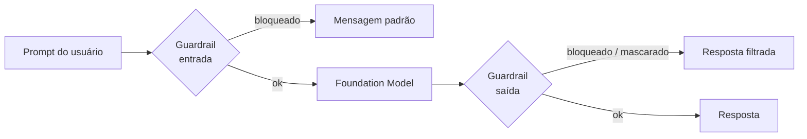

## Resumo

**Amazon Bedrock Guardrails** cria **proteções configuráveis** que analisam o **prompt do usuário (entrada)** e a **resposta do modelo (saída)** para bloquear conteúdo nocivo, tópicos proibidos, dados pessoais e alucinações. É o serviço central de **IA Responsável** (Domínio 4) e de **segurança de prompts** (Domínio 3).

> [!info] Ideia central
> Guardrails = **"segurança na porta"** do modelo: confere o que **entra** e o que **sai**, com as **mesmas regras** para qualquer FM.

## As 6 políticas do Guardrails (cai muito)

| # | Política | O que faz | Exemplo |
|---|---|---|---|
| 1 | **Content filters** (filtros de conteúdo) | Detecta categorias nocivas em **texto e imagem**: **ódio, insultos, sexual, violência, má conduta** e **ataque de prompt**, com força **baixa/média/alta** | Bloquear xingamentos e tentativas de **jailbreak / prompt injection** |
| 2 | **Denied topics** (tópicos negados) | Bloqueia **assuntos** que você descreve em linguagem natural | Um chatbot de banco **não dá conselho de investimento** |
| 3 | **Word filters** (filtros de palavras) | Bloqueia **palavras exatas**, palavrões e listas próprias | Nomes de **concorrentes** |
| 4 | **Sensitive information filters** (PII) | **Bloqueia ou mascara** dados pessoais (CPF, e-mail, telefone, cartão) e padrões **regex** | Trocar o e-mail do cliente por `{EMAIL}` na resposta |
| 5 | **Contextual grounding check** | Detecta **alucinação**: a resposta está **apoiada na fonte** (*grounding*) e é **relevante** para a pergunta (*relevance*)? | Bloquear respostas do RAG que inventam informações |
| 6 | **Automated Reasoning checks** | Valida a resposta contra **regras lógicas** (ex.: uma política de RH) | Conferir se a resposta respeita a política de férias |

Quando uma regra é violada, o Guardrails **bloqueia** e devolve uma **mensagem configurável** (ex.: "Não posso ajudar com esse assunto"), ou **mascara** o dado sensível.

## Onde o Guardrails se aplica

- Funciona com **qualquer FM do Bedrock**, com **Knowledge Bases** e com **Agents**.
- A API **ApplyGuardrail** avalia texto **sem chamar um modelo**. Dá para usá-la até com modelos **fora do Bedrock**.
- Um mesmo guardrail pode ser reutilizado em várias aplicações (**políticas consistentes** na empresa).
- Integra com **CloudWatch** para monitorar quantas vezes cada regra foi acionada.

## Guardrails e os riscos de prompt

| Risco | Política que ajuda |
|---|---|
| **Prompt injection / jailbreak** | Content filter → categoria **Prompt Attack** |
| **Vazamento de PII** | **Sensitive information filters** |
| **Alucinação** em RAG | **Contextual grounding check** |
| Assunto fora do escopo do app | **Denied topics** |
| Conteúdo tóxico | **Content filters** |

Mais sobre riscos: [[06 - Riscos e Segurança em Prompts|Riscos e Segurança em Prompts]].

## Guardrails x outros serviços de IA responsável

| Serviço | Para quê |
|---|---|
| **Bedrock Guardrails** | Filtrar **entrada/saída** de apps de **GenAI** em tempo real |
| **SageMaker Clarify** | Detectar **viés** em dados/modelos e **explicar** previsões |
| **SageMaker Model Monitor** | Monitorar **desvios** (*drift*) de qualidade em produção |
| **Amazon A2I** (Augmented AI) | Enviar previsões de **baixa confiança** para **revisão humana** |
| **Amazon Comprehend** | Detectar PII e toxicidade em textos (fora do fluxo do Bedrock) |
| **Amazon Macie** | Encontrar **dados sensíveis no S3** |

> [!warning] Pegadinhas
> - "Impedir que o chatbot fale de **assunto X**" → **Denied topics**.
> - "**Mascarar** dados pessoais na resposta" → **Sensitive information filters (PII)**.
> - "Detectar **alucinação** em respostas baseadas em documentos" → **Contextual grounding check**.
> - "Bloquear **jailbreak**" → **Content filters (Prompt Attack)**.
> - Guardrails **não** treina nem altera o modelo. Ele **filtra**.

## Exemplo para Associação Mental

**O Segurança da Balada.** Na **entrada**, ele barra quem chega armado (**prompt attack**) ou fora do dress code (**denied topics**). Na **saída**, confere se ninguém leva algo que não é seu (**PII**). Tem uma **lista de nomes proibidos** (**word filters**) e checa se a história que você conta **bate com a câmera** (**contextual grounding**).

---
Índice: [[00 - Índice - Bedrock|Índice - Bedrock]] · Anterior: [[06 - Bedrock Agents|Bedrock Agents]] · Próximo: [[08 - Teste - Bedrock|Teste - Bedrock]]

Fontes: [Detect and filter harmful content by using Amazon Bedrock Guardrails](https://docs.aws.amazon.com/bedrock/latest/userguide/guardrails.html) · [Create your guardrail](https://docs.aws.amazon.com/bedrock/latest/userguide/guardrails-components.html)
