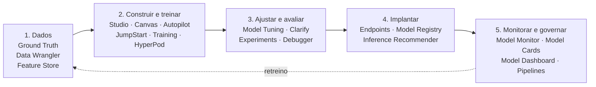

## Resumo

Ponto de partida para estudar o **Amazon SageMaker AI** no AI Practitioner. Aqui ficam todas as notas do SageMaker, na ordem recomendada de estudo, e a **matriz de cobertura da ementa**.

> [!info] Ideia central
> **SageMaker** = plataforma **completa** para **construir, treinar, implantar e monitorar** seus próprios modelos de ML. Use quando nenhum serviço pronto (Comprehend, Rekognition…) ou o Bedrock resolver.

## Ordem de estudo

| # | Nota | Para que serve |
|---|---|---|
| 1 | [[01 - Amazon SageMaker\|Amazon SageMaker]] | Visão geral, ficha rápida, mapa do ciclo de vida e pegadinhas |
| 2 | [[02 - SageMaker - Ciclo de Vida e MLOps\|SageMaker - Ciclo de Vida e MLOps]] | Pipeline de ML, origem dos modelos, API gerenciada x auto-hospedada, algoritmos, MLOps, métricas |
| 3 | [[03 - SageMaker - Data Tools\|SageMaker - Data Tools]] | Data Wrangler, Feature Store, Processing e Canvas Data Prep |
| 4 | [[04 - SageMaker - Models and Humans\|SageMaker - Models and Humans]] | Clarify (avaliação, explicabilidade, viés), Ground Truth (rotulagem, RLHF) e A2I |
| 5 | [[05 - SageMaker - IA Generativa\|SageMaker - IA Generativa]] | JumpStart x Bedrock x PartyRock x Q, fine-tuning, pré-treino, HyperPod, Scoping Matrix |
| 6 | [[06 - SageMaker - Governança e Segurança\|SageMaker - Governança e Segurança]] | Model Cards, Registry, Lineage, IAM, KMS, VPC/PrivateLink, CloudTrail/CloudWatch |
| 7 | [[04 - ML Inference\|ML Inference]] | Modos de inferência (real-time, serverless, async, batch) |
| 8 | [[07 - SageMaker - Recursos em Detalhe\|SageMaker - Recursos em Detalhe]] | Revisão: todos os recursos, pares que confundem, mapa por persona |
| 9 | [[08 - SageMaker - Formulário de Respostas\|SageMaker - Formulário de Respostas]] | Simulado com 30 questões para responder e se corrigir (sempre limpo) |
| 10 | [[09 - SageMaker - Formulário 2026-11-11 (respondido)\|SageMaker - Formulário 2026-11-11 (respondido)]] | Tentativa 1: 25/30 (83%), com correção e plano de revisão |

## Matriz de cobertura da ementa (AIF-C01)

Tudo o que o [[00 - Início - Guia do Exame|Guia do Exame]] cobra sobre SageMaker e onde está nesta pasta.

| Domínio / Tarefa | O que o guia cobra | Onde estudar | Questões |
|---|---|---|---|
| **D1 · 1.1** | Inferência batch x tempo real | [[04 - ML Inference\|ML Inference]] · [[07 - SageMaker - Recursos em Detalhe\|SageMaker - Recursos em Detalhe]] | 6, 9, 15 |
| **D1 · 1.2** | SageMaker entre os serviços de IA/ML; regressão, classificação, clusterização | [[01 - Amazon SageMaker\|Amazon SageMaker]] · [[02 - SageMaker - Ciclo de Vida e MLOps\|SageMaker - Ciclo de Vida e MLOps]] (algoritmos) | 21 |
| **D1 · 1.3** | Etapas do pipeline e serviços (Data Wrangler, Feature Store, Model Monitor) | [[02 - SageMaker - Ciclo de Vida e MLOps\|SageMaker - Ciclo de Vida e MLOps]] · [[03 - SageMaker - Data Tools\|SageMaker - Data Tools]] | 3, 8, 13 |
| **D1 · 1.3** | Modelos pré-treinados open source x treinados sob medida | [[02 - SageMaker - Ciclo de Vida e MLOps\|SageMaker - Ciclo de Vida e MLOps]] | 5 |
| **D1 · 1.3** | API gerenciada x auto-hospedada | [[02 - SageMaker - Ciclo de Vida e MLOps\|SageMaker - Ciclo de Vida e MLOps]] | 22 |
| **D1 · 1.3** | MLOps: experimentação, repetibilidade, escala, dívida técnica, produção, monitoramento, retreino | [[02 - SageMaker - Ciclo de Vida e MLOps\|SageMaker - Ciclo de Vida e MLOps]] | 10, 16, 23 |
| **D1 · 1.3** | Métricas técnicas e de negócio | [[02 - SageMaker - Ciclo de Vida e MLOps\|SageMaker - Ciclo de Vida e MLOps]] | 24 |
| **D2 · 2.3** | Bedrock x JumpStart x PartyRock x Amazon Q | [[05 - SageMaker - IA Generativa\|SageMaker - IA Generativa]] | 5, 20 |
| **D3 · 3.1** | Custos de customização (prompt, RAG, fine-tuning, pré-treino) | [[05 - SageMaker - IA Generativa\|SageMaker - IA Generativa]] | 25 |
| **D3 · 3.3** | Fine-tuning, pré-treino contínuo, transfer learning, RLHF | [[05 - SageMaker - IA Generativa\|SageMaker - IA Generativa]] · [[04 - SageMaker - Models and Humans\|SageMaker - Models and Humans]] | 19, 25, 26 |
| **D3 · 3.4** | Avaliação de FMs (humana e benchmark) | [[04 - SageMaker - Models and Humans\|SageMaker - Models and Humans]] (Clarify) | 27 |
| **D4 · 4.1** | Viés: Clarify, Model Monitor, A2I, Ground Truth, auditoria humana | [[04 - SageMaker - Models and Humans\|SageMaker - Models and Humans]] | 1, 2, 14 |
| **D4 · 4.2** | Transparência: Model Cards, open source, licenças | [[06 - SageMaker - Governança e Segurança\|SageMaker - Governança e Segurança]] | 7 |
| **D5 · 5.1** | IAM, criptografia, PrivateLink, Macie, linhagem de dados | [[06 - SageMaker - Governança e Segurança\|SageMaker - Governança e Segurança]] | 28, 29 |
| **D5 · 5.2** | CloudTrail, CloudWatch, Config; retenção, residência, logs | [[06 - SageMaker - Governança e Segurança\|SageMaker - Governança e Segurança]] | 30 |

## Mapa do ciclo de vida

## Relacionadas
- [[01 - Amazon Bedrock|Amazon Bedrock]] · [[00 - Índice - Bedrock|Índice - Bedrock]]
- [[13 - Amazon Augmented AI|Amazon Augmented AI]] (não confundir com Ground Truth)
- [[00 - Resumo - Serviços de IA|Resumo - Serviços de IA]] dos serviços de IA
- Guia: [[02 - Domínio 1 - Fundamentos de IA e ML]] · [[03 - Domínio 2 - Fundamentos de IA Generativa]] · [[04 - Domínio 3 - Aplicações de Foundation Models]] · [[05 - Domínio 4 - Diretrizes para IA Responsável]] · [[06 - Domínio 5 - Segurança, Compliance e Governança]]

## Checklist

- [ ] Li a visão geral
- [ ] Sei o recurso do SageMaker de cada etapa do pipeline
- [ ] Sei diferenciar API gerenciada x auto-hospedada e modelo pré-treinado x sob medida
- [ ] Sei os conceitos de MLOps e o recurso de cada um
- [ ] Sei o que fazem as Data Tools
- [ ] Sei as 3 funções do Clarify e a diferença Ground Truth x A2I
- [ ] Sei quando usar JumpStart x Bedrock x PartyRock x Q
- [ ] Sei as camadas de segurança e governança do SageMaker
- [ ] Fiz o formulário e acertei 24+ de 30
