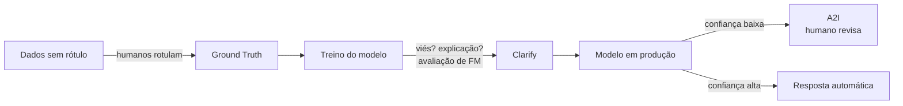

## Resumo

Os recursos de **Models and Humans** do SageMaker cuidam de **avaliar modelos, garantir que sejam justos e explicáveis, e colocar humanos no processo** (*human-in-the-loop*). Na prova, aparecem muito no **Domínio 4 (IA Responsável)** e em perguntas sobre **avaliação de modelos** e **RLHF**.

> [!info] Ideia central
> - **Clarify** → **avalia** FMs, **explica** previsões e **detecta viés**.
> - **Ground Truth** → humanos **rotulam dados** e dão **feedback** (RLHF).
> - **Augmented AI (A2I)** → humanos **revisam previsões** de baixa confiança em produção.

---

## 1. SageMaker Clarify

**Para que serve:** ferramenta de **IA Responsável** com **três funções**. Grave as três, porque a prova cobra todas.

### 1.1 Avaliação de Foundation Models (*Model Evaluation*)

Compara e avalia FMs (ex.: escolher entre dois LLMs para sua aplicação).

| Tipo | Como funciona | Quando usar |
|---|---|---|
| **Automática** | Usa **métricas** e **datasets prontos** (ou os seus) | Medir de forma objetiva: precisão, robustez, toxicidade |
| **Humana** | Pessoas avaliam as respostas: **seus funcionários** ou **equipe gerenciada pela AWS** | Critérios subjetivos: tom, **estilo**, alinhamento com a **voz da marca**, criatividade |

- **O que avalia:** **precisão**, **robustez**, **toxicidade**, **estereótipos** (*prompt stereotyping*), conhecimento factual.
- **Tarefas:** geração de texto, resumo, perguntas e respostas (Q&A), classificação.
- Funciona com modelos do **JumpStart** e do **Bedrock** (o Bedrock tem sua própria *Model Evaluation* com a mesma ideia).

### 1.2 Explicabilidade (*Model Explainability*)

Mostra **por que** o modelo tomou uma decisão, ou seja, **quais features mais influenciaram** a previsão.

- Usa **SHAP** (valores de importância de cada feature) e **Partial Dependence Plots** (como a previsão muda quando uma feature varia).
- Explicação **global** (o modelo inteiro) e **local** (uma previsão específica).
- **Caso de uso:** "Por que o crédito do João foi negado?" → renda baixa pesou 45%, histórico de atraso pesou 30%.
- Ajuda a **ganhar confiança**, **depurar** o modelo e atender **regulação**.

### 1.3 Detecção de viés (*Bias Detection*)

Detecta se o modelo ou os dados **favorecem ou prejudicam grupos** (gênero, idade, etnia…).

| Momento | O que mede | Exemplo de métrica |
|---|---|---|
| **Pré-treino** (nos **dados**) | Dados **desbalanceados** ou mal representados | **Class Imbalance (CI)**: há muito menos exemplos de um grupo |
| **Pós-treino** (no **modelo**) | Previsões **injustas** entre grupos | **Difference in Positive Proportions in Predicted Labels (DPPL)**: um grupo é aprovado muito mais que outro |

- Você escolhe a **faceta** (*facet*), que é o atributo sensível analisado (ex.: `gênero`).
- O **Model Monitor** usa o Clarify para vigiar **viés e explicabilidade em produção** (*bias drift*).

> [!note] Tipos de viés que caem na prova
> | Tipo | O que é |
> |---|---|
> | **Sampling bias** (amostragem) | Os dados **não representam** a população (ex.: só clientes de uma região) |
> | **Measurement bias** (medição) | Ferramenta de coleta **distorce** os dados |
> | **Observer bias** (observador) | Quem rotula deixa sua **opinião** influenciar |
> | **Confirmation bias** (confirmação) | Buscar/interpretar dados que **confirmam** o que já se acredita |

> [!warning] Na prova
> - "**Comparar/avaliar FMs**" com métricas ou com avaliadores humanos → **Clarify** (ou Bedrock Model Evaluation).
> - "**Explicar** previsões", "quais **fatores** influenciaram", "SHAP" → **Clarify**.
> - "Detectar **viés** nos dados ou no modelo" → **Clarify**.

---

## 2. SageMaker Ground Truth

**Para que serve:** colocar **humanos no processo** para **rotular dados** e dar **feedback** a modelos.

### O que ele faz

| Uso | Exemplo |
|---|---|
| **Rotular dados para treino** | Marcar caixas em carros nas imagens, classificar textos como positivo/negativo, transcrever áudio |
| **RLHF** (*Reinforcement Learning from Human Feedback*) | Humanos **ranqueiam** respostas de um LLM ("a resposta A é melhor que a B") → o modelo aprende a preferência humana |
| **Revisão e avaliação de modelos** | Humanos avaliam a qualidade das saídas do modelo |
| **Personalização / alinhamento** | Gerar dados de demonstração para fine-tuning |

### Quem faz o trabalho (*workforce*)

| Opção | Quando usar |
|---|---|
| **Amazon Mechanical Turk** | Força de trabalho **pública** e grande, para tarefas simples e **não sensíveis** |
| **Equipe privada** (*private workforce*) | **Seus funcionários**, para dados **confidenciais** ou que exigem conhecimento interno |
| **Fornecedores** (*vendors*, via AWS Marketplace) | Empresas especializadas em rotulagem |
| **Ground Truth Plus** | A **AWS fornece e gerencia** a equipe especializada. Você só envia os dados (*turnkey*) |

- **Rotulagem automática** (*automated data labeling* / *active learning*): o modelo aprende com os rótulos humanos e **rotula sozinho os casos fáceis**. Só os difíceis vão para humanos, o que **reduz custo** (até ~70%).

> [!warning] Na prova
> - "**Rotular** dados", "anotar imagens", "criar dataset rotulado" → **Ground Truth**.
> - "**RLHF**", "feedback humano para alinhar o modelo" → **Ground Truth**.
> - "Rotulagem **gerenciada pela AWS**, sem montar equipe" → **Ground Truth Plus**.

---

## 3. Amazon Augmented AI (A2I)

**Para que serve:** **revisão humana de previsões** de um modelo **já em produção**, normalmente quando a **confiança é baixa**. Detalhes em [[13 - Amazon Augmented AI|Amazon Augmented AI]].

- Integra com **Textract**, **Rekognition** e modelos próprios do **SageMaker**.
- Usa as mesmas opções de workforce do Ground Truth (Mechanical Turk, privada, fornecedores).
- **Caso de uso:** o Textract leu um valor de nota fiscal com 60% de confiança → manda para uma pessoa conferir.

---

## Ground Truth x A2I x Clarify (o trio que confunde)

| | **Ground Truth** | **A2I** | **Clarify** |
|---|---|---|---|
| **Momento** | **Antes** do treino (dados) | **Depois** do deploy (produção) | Antes, durante e depois do treino |
| **Papel do humano** | **Rotular** dados / dar feedback (RLHF) | **Revisar** previsões duvidosas | Opcional: **avaliar FMs** (avaliação humana) |
| **Pergunta que responde** | "Qual o rótulo correto deste dado?" | "Esta previsão está certa?" | "O modelo é **justo**? **Por que** decidiu isso? Qual FM é melhor?" |
| **Palavra-chave** | rotular, anotar, RLHF | revisão humana, baixa confiança | viés, explicabilidade, SHAP, avaliar FM |

## Governança (relacionado)

Esses recursos completam o lado de IA Responsável. Detalhes em [[07 - SageMaker - Recursos em Detalhe|SageMaker - Recursos em Detalhe]].

| Recurso | Para que serve |
|---|---|
| **Model Cards** | **Documentar** o modelo: uso pretendido, riscos, métricas (pode incluir resultados do Clarify) |
| **Model Monitor** | Vigiar **drift** em produção, inclusive **bias drift** (usando o Clarify) |
| **Model Dashboard** | Ver todos os modelos e alertas em um só lugar |
| **Role Manager** | Permissões IAM por persona |

> [!warning] Pegadinhas de prova
> - Humano **antes** do treino → **Ground Truth**. Humano **depois**, em produção → **A2I**.
> - "Avaliar o **tom / estilo / voz da marca** de um LLM" → avaliação **humana** (Clarify ou Bedrock Model Evaluation), não automática.
> - "Viés **em produção ao longo do tempo**" → **Model Monitor** (com Clarify). Viés numa **análise pontual** → **Clarify**.
> - "**Documentar** os resultados de viés para auditoria" → **Model Cards**.

## Exemplo para Associação Mental

**O tribunal.** O **Ground Truth** é o **professor que corrige as provas** usadas para ensinar o aluno (o modelo). O **Clarify** é o **juiz**: verifica se o aluno é **justo** com todos (viés), pede que ele **explique a decisão** (explicabilidade) e compara candidatos (avaliação de FMs). O **A2I** é o **supervisor no dia a dia**: quando o aluno fica em dúvida no trabalho, chama uma pessoa para conferir.

## 📝 Meu entendimento

> _Explique com suas palavras quando usar Ground Truth, A2I e Clarify._

---
Voltar: [[00 - Índice - SageMaker|Índice - SageMaker]] · Anterior: [[03 - SageMaker - Data Tools|SageMaker - Data Tools]] · Relacionadas: [[01 - Amazon SageMaker|Amazon SageMaker]] · [[13 - Amazon Augmented AI|Amazon Augmented AI]] · [[08 - SageMaker - Formulário de Respostas|SageMaker - Formulário de Respostas]]

Fontes: [SageMaker Clarify](https://aws.amazon.com/sagemaker-ai/clarify/) · [SageMaker Ground Truth](https://aws.amazon.com/sagemaker-ai/groundtruth/) · [Amazon Augmented AI](https://aws.amazon.com/augmented-ai/)
