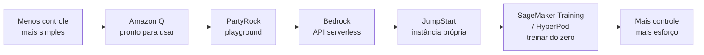

## Resumo

Como o SageMaker aparece nos **Domínios 2 e 3** ([[03 - Domínio 2 - Fundamentos de IA Generativa]] · [[04 - Domínio 3 - Aplicações de Foundation Models]]): **JumpStart**, **fine-tuning**, **pré-treino contínuo**, **treino de FMs**, **avaliação de FMs** e **RLHF**, além de **quando escolher SageMaker em vez de Bedrock**.

> [!info] Ideia central
> **Bedrock** = usar FMs **por API, serverless**, sem gerenciar nada.
> **SageMaker** = FMs com **mais controle**: escolher instância, rodar na sua VPC, fazer fine-tuning profundo ou **treinar seu próprio modelo**.

---

## 1. Bedrock x JumpStart x PartyRock x Amazon Q

Comparação que o guia cobra explicitamente (⭐⭐⭐).

| Serviço | O que é | Quem usa | Controle de infra | Palavra-chave |
|---|---|---|---|---|
| **Amazon Bedrock** | FMs de vários fornecedores por **uma API**, **serverless** | Desenvolvedores | ❌ Nenhum (gerenciado) | "API", "serverless", "sem gerenciar infraestrutura" |
| **SageMaker JumpStart** | **Hub** de modelos pré-treinados e FMs que você **implanta em instâncias SageMaker** | Cientistas de dados / engenheiros de ML | ✅ Escolhe instância, VPC | "mais controle", "implantar modelo open source", "fine-tuning na sua conta" |
| **PartyRock** | **Playground gratuito** do Bedrock para criar apps de GenAI **sem código** | Qualquer pessoa, para aprender | ❌ | "aprender", "experimentar", "sem conta AWS / sem código" |
| **Amazon Q** | **Assistente pronto** de GenAI (Q Business para empresa, Q Developer para código) | Funcionários, devs | ❌ | "assistente", "chat com dados da empresa", "ajuda com código" |
| **SageMaker Canvas** | ML no-code; também permite **conversar com FMs** e ajustar modelos sem código | Analistas | ❌ | "sem código" + GenAI para analista |

---

## 2. SageMaker JumpStart em detalhe

- **Catálogo** com centenas de modelos: FMs (texto, imagem, código) e modelos clássicos de visão, NLP e tabulares.
- **Deploy com 1 clique**: cria um **endpoint SageMaker** na sua conta.
- **Fine-tuning** com seus dados (geralmente no S3), sem escrever o código de treino.
- **Avaliação** dos modelos (usa o Clarify por trás).
- **Soluções prontas** para casos comuns (ex.: previsão de demanda, detecção de fraude).
- Roda **dentro da sua VPC**, com **seus controles de segurança** → seus dados não saem da conta.

**Casos de uso:**
- Implantar o **Llama** numa instância GPU específica, isolada na VPC, por requisito de compliance.
- Fazer **fine-tuning** de um modelo open source com dados internos e manter **controle total** do modelo resultante.

---

## 3. Customizar e treinar FMs no SageMaker

Do mais barato ao mais caro (Tarefa 3.1 e 3.3):

| Abordagem | Altera o modelo? | Dados | Onde no SageMaker |
|---|---|---|---|
| **Prompt engineering / in-context learning** | ❌ | Exemplos no prompt | Qualquer endpoint (JumpStart) |
| **RAG** | ❌ | Documentos (base de conhecimento) | Possível montar com endpoint + banco vetorial; mais simples no **Bedrock Knowledge Bases** |
| **Fine-tuning / instruction tuning** | ✅ | **Rotulados** (prompt → resposta) | **JumpStart** (fine-tune), **Training Jobs** |
| **Pré-treino contínuo** (*domain adaptation*) | ✅ | **Não rotulados** de um domínio (jurídico, médico) | **Training Jobs**, **HyperPod** |
| **Pré-treino do zero** | ✅ | Volume enorme, não rotulado | **HyperPod** (clusters resilientes com centenas de GPUs) |

- **Transfer learning**: aproveitar um modelo já treinado (do JumpStart) e adaptar para a sua tarefa. É a base do fine-tuning.
- **PEFT / LoRA**: técnicas de fine-tuning que ajustam **só uma parte** do modelo → mais barato. (Extra; aparece pouco.)
- **Preparação dos dados** para fine-tuning: curadoria, **representatividade**, tamanho adequado, **rotulagem** (**Ground Truth**) e governança.

---

## 4. RLHF e avaliação de FMs

| Necessidade | Recurso | Nota |
|---|---|---|
| **RLHF**: humanos ranqueiam respostas para alinhar o modelo | **Ground Truth** (e Ground Truth Plus) | [[04 - SageMaker - Models and Humans\|SageMaker - Models and Humans]] |
| **Avaliação automática** de FMs (precisão, robustez, toxicidade, estereótipos) com datasets de benchmark | **Clarify** (FM evaluation) / **Bedrock Model Evaluation** | [[04 - SageMaker - Models and Humans\|SageMaker - Models and Humans]] |
| **Avaliação humana** (tom, estilo, voz da marca) | **Clarify** com sua equipe ou equipe AWS / Bedrock Model Evaluation | |
| Métricas **ROUGE** (resumo), **BLEU** (tradução), **BERTScore** (semântica) | Usadas na avaliação automática | [[04 - Domínio 3 - Aplicações de Foundation Models]] |

---

## 5. Generative AI Security Scoping Matrix: onde entra o SageMaker

| Escopo | Situação | Serviço típico |
|---|---|---|
| 1 | App de consumidor | Chatbot público |
| 2 | App corporativo (SaaS) | **Amazon Q** |
| 3 | Modelo pré-treinado via API | **Bedrock** |
| 4 | Modelo com **fine-tuning** | **Bedrock** (custom model) ou **SageMaker JumpStart / Training** |
| 5 | Modelo **treinado do zero** | **SageMaker** (Training, **HyperPod**) |

Quanto maior o escopo, **mais responsabilidade do cliente** (dados de treino, segurança do modelo, governança).

> [!warning] Pegadinhas de prova
> - "Usar FM **sem gerenciar infraestrutura**" → **Bedrock**, não SageMaker.
> - "Implantar FM open source com **controle da instância / VPC**" → **JumpStart**.
> - "**Treinar um LLM do zero** em larga escala" → **SageMaker HyperPod**.
> - "Ensinar o modelo um **domínio novo** com muitos dados **não rotulados**" → **pré-treino contínuo**.
> - "Mudar o **estilo/tarefa** com pares **rotulados**" → **fine-tuning**.
> - "Feedback humano para **alinhar** respostas" → **RLHF** com **Ground Truth**.
> - "**Aprender/experimentar** GenAI sem código" → **PartyRock**.

## 📝 Meu entendimento

> _Explique quando você escolheria JumpStart em vez de Bedrock._

---
Voltar: [[00 - Índice - SageMaker|Índice - SageMaker]] · Relacionadas: [[01 - Amazon Bedrock|Amazon Bedrock]] · [[00 - Índice - Bedrock|Índice - Bedrock]] · [[02 - Foundation Models|Foundation Models]] · [[16 - Amazon Q|Amazon Q]]

Fontes: [SageMaker JumpStart](https://aws.amazon.com/sagemaker-ai/jumpstart/) · [SageMaker HyperPod](https://aws.amazon.com/sagemaker-ai/hyperpod/) · [Generative AI Security Scoping Matrix](https://aws.amazon.com/ai/security/generative-ai-scoping-matrix/)
