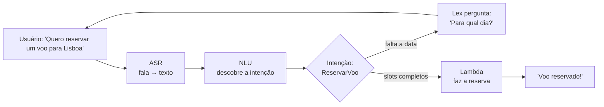

## Resumo

O **Amazon Lex** é o serviço para **criar chatbots e assistentes conversacionais** de **voz e texto**. Ele usa a **mesma tecnologia da Alexa**: entende o que o usuário fala ou escreve, **identifica a intenção**, pede as informações que faltam e **executa a ação** (ex.: reservar um voo). Pode ser colocado em qualquer aplicação nova ou existente.

> [!info] Ideia central
> **Conversa → intenção → ação.** O Lex **conversa**: entende o pedido, faz perguntas e resolve. É o único serviço da lista feito para **diálogo**.
> 🔑 Palavras-chave na prova: "**chatbot**", "**conversacional**", "**assistente virtual**", "**URA inteligente**", "**intenção**", "**Alexa**".

## Ficha rápida

| Item | Detalhe |
|---|---|
| **Categoria** | IA conversacional (ASR + NLU) |
| **Entrada** | Fala ou texto do usuário |
| **Saída** | Resposta (texto ou voz) e **ação executada** (via AWS Lambda) |
| **Precisa saber ML?** | Não. Você define **intenções e exemplos de frases** e o Lex treina sozinho |
| **Customização** | Intenções, *slots*, prompts, Lambda e recursos generativos via **Bedrock** |
| **Modos** | Tempo real (conversa) |
| **Na prova** | Domínio 1 · Tarefa 1.2 · ⭐⭐⭐ |
| **Status 2026** | ✅ Disponível |

## Como funciona

| Conceito | O que é | Exemplo |
|---|---|---|
| **Bot** | O assistente completo | "Assistente da Companhia Aérea" |
| **Intenção** (*intent*) | O **objetivo** do usuário | `ReservarVoo`, `ConsultarStatus` |
| **Enunciados** (*utterances*) | Frases de exemplo que ativam a intenção | "Quero viajar", "Reservar passagem" |
| **Slots** | **Informações** necessárias para cumprir a intenção | Destino, data, nº de passageiros |
| **Prompts** | Perguntas que o bot faz para preencher os slots | "Para qual cidade?" |
| **Fulfillment** | A **execução** da ação, geralmente uma **função Lambda** | Grava a reserva no sistema |

## Principais recursos

| Recurso | O que faz |
|---|---|
| **ASR + NLU** integrados | Reconhece a fala **e** entende a linguagem natural |
| **Diálogo com várias etapas** | Pergunta o que falta até completar o pedido |
| **Integração com Lambda** | Executa a lógica de negócio e chama sistemas |
| **Canais prontos** | **Amazon Connect** (call center), Slack, Facebook Messenger, Twilio, web e mobile |
| **Vários idiomas** | Um mesmo bot em vários idiomas |
| **Recursos generativos** (com Bedrock) | Criar o bot **descrevendo-o em linguagem natural**, gerar exemplos de frases, preencher slots com ajuda de LLM e **responder perguntas usando uma base de conhecimento** (QnAIntent) |

## Casos de uso

| Cenário | Como o Lex ajuda |
|---|---|
| **Atendimento ao cliente** | Chatbot que responde dúvidas e resolve pedidos 24h |
| **Call center (URA inteligente)** | Com **Amazon Connect**, o cliente fala o que quer em vez de "digite 1" |
| **Reservas e agendamentos** | Voos, consultas, restaurantes |
| **Helpdesk interno** | Reset de senha, abertura de chamado |
| **Apps e dispositivos** | Interface de voz para aplicações |

## Lex x outros serviços de NLP e x Transcribe

> [!question] Qual a diferença entre o Lex, os outros serviços de NLP e o Transcribe?
> A diferença está em **até onde cada serviço vai** com a linguagem:
>
> | Serviço | Ouve? | Entende? | Conversa e age? | O que entrega |
> |---|---|---|---|---|
> | [[04 - Amazon Transcribe|Amazon Transcribe]] | ✅ | ❌ | ❌ | **Texto** do que foi dito |
> | [[01 - Amazon Comprehend|Amazon Comprehend]] | ❌ (só texto) | ✅ analisa | ❌ | **Insights** (sentimento, entidades) |
> | [[05 - Amazon Polly|Amazon Polly]] | ❌ | ❌ | ❌ (só fala) | **Áudio** a partir de texto |
> | [[03 - Amazon Translate|Amazon Translate]] | ❌ | ❌ | ❌ | **Texto traduzido** |
> | [[09 - Amazon Kendra|Amazon Kendra]] | ❌ | ✅ busca | ❌ | **Documento/resposta** encontrado |
> | **Amazon Lex** | ✅ | ✅ intenção | ✅ | **Diálogo + ação** |
>
> - O **Transcribe** é um "ouvido que escreve": converte fala em texto e para por aí. É ótimo para **gravações** (ligações, reuniões, vídeos).
> - O **Comprehend** é um "leitor que analisa": recebe um texto pronto e extrai informações, mas **não interage** com ninguém.
> - O **Lex** junta **ouvir (ASR, como o Transcribe)** + **entender a intenção (NLU)** + **gerenciar o diálogo** + **executar a ação**. Ele é feito para uma **conversa ao vivo** com um usuário.
>
> Regra prática: se a questão fala em **conversar com o usuário** → **Lex**. Se fala em **transcrever um áudio** → **Transcribe**. Se fala em **analisar um texto** → **Comprehend**.

## Não confunda

| Serviço | Diferença |
|---|---|
| [[01 - Amazon Bedrock\|Amazon Bedrock]] (Agents) | Chatbot **generativo** com LLM, mais flexível. O Lex é focado em **fluxos estruturados** (intenções e slots). Hoje dá para combinar os dois |
| [[16 - Amazon Q\|Amazon Q]] | Assistente **pronto** para funcionários. O Lex é um **construtor** de bots para a sua aplicação |
| **Amazon Connect** | Plataforma de **call center** que usa o Lex para a URA |

> [!warning] Pegadinhas de prova
> - "Criar um **chatbot** de voz ou texto" → **Lex**.
> - "URA que entende o cliente **falando naturalmente**" → **Lex + Amazon Connect**.
> - "**Mesma tecnologia da Alexa**" → **Lex**.
> - "Transcrever gravações **depois** da ligação" → **Transcribe**, não Lex.

## Exemplo para Associação Mental

**A Recepcionista do Hotel.** O Transcribe é o **taquígrafo** que só anota. O Comprehend é o **analista** que lê as anotações depois. O **Lex é a recepcionista**: escuta você, entende que você quer **um quarto** (intenção), pergunta **"para quantas noites?"** (slot) e **faz a reserva no sistema** (Lambda).

## 📝 Meu entendimento

> PALAVRA CHAVE PARA IDENTIFICAR ESSE CASO DE USO É CHATBOT / CONVERSACIONAL

---
Resumo: [[00 - Resumo - Serviços de IA|Resumo - Serviços de IA]] · Anterior: [[05 - Amazon Polly|Amazon Polly]] · Próximo: [[07 - Amazon Rekognition|Amazon Rekognition]]

Fontes: [Amazon Lex](https://aws.amazon.com/pt/lex/) · [Recursos do Amazon Lex](https://aws.amazon.com/pt/lex/features/)
