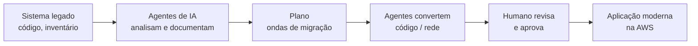

## Resumo

O **AWS Transform** é o serviço da AWS que usa **agentes de IA (IA agêntica)** para **migrar e modernizar sistemas legados**: aplicações **.NET Framework** (Windows), **mainframes** (COBOL em IBM z/OS) e ambientes **VMware**, além de transformações de código personalizadas. Nasceu como os recursos de *transformation* do **Amazon Q Developer** (preview no re:Invent 2024) e virou serviço próprio em 2025.

> [!info] Ideia central
> **Sistema legado → aplicação moderna na AWS, com agentes de IA fazendo o trabalho pesado.** Os agentes analisam o código, planejam, convertem e testam; humanos revisam e aprovam.
> 🔑 Palavras-chave na prova: "**modernizar**", "**legado**", "**mainframe / COBOL**", "**.NET Framework → .NET moderno/Linux**", "**migrar VMware**", "**agentes de IA para migração**".

## Ficha rápida

| Item | Detalhe |
|---|---|
| **Categoria** | Machine Learning (IA agêntica aplicada a migração e modernização) |
| **Entrada** | Código-fonte e inventário de sistemas legados |
| **Saída** | Plano de migração, código modernizado, testes, documentação |
| **Precisa saber ML?** | Não. Agentes prontos; você conduz o projeto no console web do serviço |
| **Humano no loop** | Sim: a equipe **revisa e aprova** cada etapa (colaboração humano + agente) |
| **Na prova** | Domínio 2 (casos de uso de GenAI) · ⭐ (novo na lista oficial de 29/10/2026) |
| **Status 2026** | ✅ Disponível |

## O que ele moderniza

| Área | O que os agentes fazem |
|---|---|
| **.NET** | Converte **.NET Framework** (só Windows) para **.NET moderno multiplataforma**, permitindo rodar em **Linux** e containers → reduz custo de licença Windows |
| **Mainframe** | Analisa código **COBOL / IBM z/OS**, gera documentação, divide em domínios e **refatora para Java**, planejando ondas de migração |
| **VMware** | Descobre servidores, planeja ondas, converte a **rede** e migra VMs para **Amazon EC2** |
| **Transformações personalizadas** | Atualizações de linguagem/framework em escala (ex.: versões de Java, SDKs) com regras definidas pela empresa |

## Como funciona

## Casos de uso

| Cenário | Por que AWS Transform |
|---|---|
| Banco com sistema **COBOL** de 30 anos e poucos especialistas | Agentes **documentam** e **convertem** o código para Java |
| Empresa quer sair do **Windows** para cortar licenças | Porta apps **.NET Framework** para .NET em **Linux** |
| Data center com milhares de **VMs VMware** | Automatiza descoberta, planejamento e migração para EC2 |

## Não confunda

| Serviço | Diferença |
|---|---|
| **Amazon Q Developer** ([[16 - Amazon Q\|Amazon Q]]) | Assistente de **código do dia a dia** (gerar, explicar, testar). O Transform é para **projetos de modernização** de sistemas inteiros |
| **Kiro** ([[07 - Ferramentas de Desenvolvimento (Kiro e Strands)\|Ferramentas de Desenvolvimento (Kiro e Strands)]]) | IDE agêntica para **construir software novo** a partir de especificações. O Transform **converte o legado** |
| **AWS Migration Hub / Application Migration Service / DMS** | Ferramentas clássicas de migração, **fora do escopo** da prova |
| [[01 - Amazon Bedrock\|Amazon Bedrock]] | Plataforma para **você construir** apps de GenAI. O Transform é um **serviço pronto** que usa GenAI para um fim específico |

> [!warning] Pegadinhas de prova
> - "Usar **IA generativa/agentes** para **acelerar a modernização** de **mainframe** ou **.NET**" → **AWS Transform**.
> - Questões antigas podem chamar isso de "**Amazon Q Developer transformation**" ou "**Q Code Transformation**" (upgrade de Java): é o mesmo conceito.

## Exemplo para Associação Mental

**A equipe de reforma.** O sistema legado é uma **casa antiga** (COBOL, .NET Framework, VMware). O **AWS Transform** manda uma **equipe de robôs** que mede tudo, desenha a **planta da reforma**, troca a fiação (código) e mostra cada cômodo para você **aprovar**. No fim, a casa é a mesma, mas moderna e na AWS.

## 📝 Meu entendimento

> _Explique com suas palavras: quando usar o AWS Transform e não o Q Developer ou o Kiro?_

---
Resumo: [[00 - Resumo - Serviços de IA|Resumo - Serviços de IA]] · Relacionadas: [[16 - Amazon Q|Amazon Q]] · [[07 - Ferramentas de Desenvolvimento (Kiro e Strands)|Ferramentas de Desenvolvimento (Kiro e Strands)]]

Fontes: [AIF-C01 – In-scope services](https://docs.aws.amazon.com/aws-certification/latest/ai-practitioner-01/aif-01-in-scope-services.html) · [AWS Transform](https://aws.amazon.com/transform/) · [AWS Transform – generally available](https://aws.amazon.com/blogs/migration-and-modernization/aws-transform-generally-available)
