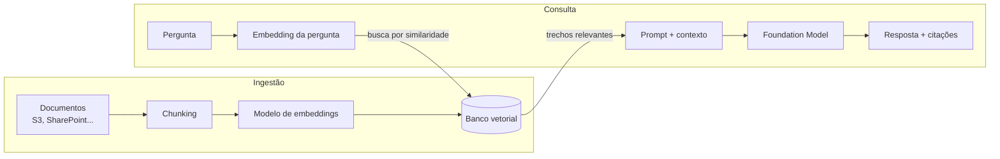

## Resumo

**RAG (Retrieval-Augmented Generation)** é a técnica de **buscar trechos relevantes nos seus documentos** e **colocá-los no prompt** antes de o modelo responder. **Amazon Bedrock Knowledge Bases** faz isso de forma **gerenciada**: ingestão, *chunking*, embeddings, banco vetorial e busca.

> [!info] Ideia central
> RAG dá ao modelo **dados atuais e privados** **sem retreinar**. Isso reduz **alucinação** e permite **citar a fonte**.

## Por que usar RAG

| Problema do FM | Como o RAG resolve |
|---|---|
| Não conhece **dados da sua empresa** | Busca nos seus documentos |
| Conhecimento **desatualizado** (data de corte) | Basta atualizar os documentos e sincronizar |
| **Alucina** | Responde com base no contexto recuperado |
| Não diz de onde tirou a resposta | Retorna **citações** das fontes |
| Fine-tuning é caro e demorado | RAG **não muda o modelo** |

## Como funciona

1. **Ingestão**: os documentos são divididos em **chunks** (pedaços).
2. Cada chunk vira um **vetor** (lista de números que representa o significado) via **modelo de embeddings**.
3. Os vetores são guardados num **banco vetorial**.
4. **Consulta**: a pergunta também vira vetor e o sistema busca os chunks **mais parecidos** (*similarity search*).
5. Os chunks entram no **prompt** e o FM gera a resposta com citações.

## Componentes do Bedrock Knowledge Bases

| Componente | Opções |
|---|---|
| **Fontes de dados** | **Amazon S3**, web crawler, Confluence, SharePoint, Salesforce, conectores customizados |
| **Dados estruturados** | Pergunta em linguagem natural → **SQL** (ex.: Amazon Redshift) |
| **Parsing** | Padrão, ou **Bedrock Data Automation** / FM para documentos com imagens, tabelas e layouts complexos |
| **Chunking** | **Fixo** (padrão: cerca de 300 tokens), **hierárquico**, **semântico**, sem chunking ou **customizado via Lambda** |
| **Embeddings** | **Amazon Titan Text Embeddings**, **Cohere Embed** |
| **Banco vetorial** | Veja a tabela abaixo |
| **APIs** | **Retrieve** (só busca os trechos) · **RetrieveAndGenerate** (busca **e** gera a resposta) |
| **Extras** | Filtro por metadados, busca híbrida, **reranking**, GraphRAG (Neptune Analytics) |

## Bancos vetoriais na AWS (cai muito)

| Serviço | Observação |
|---|---|
| **Amazon OpenSearch Serverless** | Padrão do *quick create* do Knowledge Bases; busca vetorial + texto |
| **Amazon OpenSearch Service** (cluster gerenciado) | Mesma ideia, você gerencia o cluster |
| **Amazon S3 Vectors** | Armazena vetores direto no S3; **baixo custo** |
| **Amazon Aurora PostgreSQL** (pgvector) | Banco relacional com extensão vetorial |
| **Amazon RDS for PostgreSQL** (pgvector) | Idem, no RDS |
| **Amazon Neptune Analytics** | Banco de **grafos**; usado para **GraphRAG** |
| **Amazon DocumentDB** | Banco de documentos (compatível com MongoDB) com busca vetorial |
| **Amazon MemoryDB** | Em memória; busca vetorial de **latência muito baixa** |
| Terceiros | Pinecone, Redis Enterprise Cloud, MongoDB Atlas |

> [!tip] Dica para lembrar
> A ementa oficial lista: **OpenSearch, Aurora, Neptune, DocumentDB e RDS for PostgreSQL**. Se a questão pede "banco **vetorial** na AWS", procure um desses nomes.

## RAG x Fine-tuning

| | RAG | Fine-tuning |
|---|---|---|
| Muda o modelo? | ❌ Não | ✅ Sim |
| Dados que mudam com frequência | ✅ Ideal | ❌ Precisa retreinar |
| Citar fonte | ✅ Sim | ❌ Não |
| Custo | 💲💲 Médio | 💲💲💲 Alto |
| Bom para | **Conhecimento** (fatos, documentos) | **Comportamento** (estilo, formato, tarefa) |

> [!warning] Pegadinhas
> - "Responder com base em **documentos internos** que **mudam com frequência**" → **RAG / Knowledge Bases**, **não** fine-tuning.
> - "Reduzir alucinação **e citar a fonte**" → **RAG**.
> - "Converter texto em vetores" → **modelo de embeddings** (ex.: Titan Embeddings).
> - "Chunk muito grande" = contexto caro e impreciso. "Chunk muito pequeno" = perde o sentido.

## Exemplo para Associação Mental

**A Prova com Consulta.** Sem RAG, o modelo faz a prova **de memória** e às vezes "chuta" com confiança (alucinação). Com RAG, ele faz a prova **com consulta**: antes de responder, procura no **fichário** (banco vetorial) as fichas (chunks) mais parecidas com a pergunta e cita a página de onde tirou a resposta.

---
Índice: [[Índice - Bedrock]] · Anterior: [[ML Inference]] · Próximo: [[Bedrock Agents]]

Fontes: [Amazon Bedrock Knowledge Bases](https://aws.amazon.com/bedrock/knowledge-bases/) · [Production RAG Architecture on Amazon Bedrock](https://hidekazu-konishi.com/entry/amazon_bedrock_rag_architecture_guide.html)
