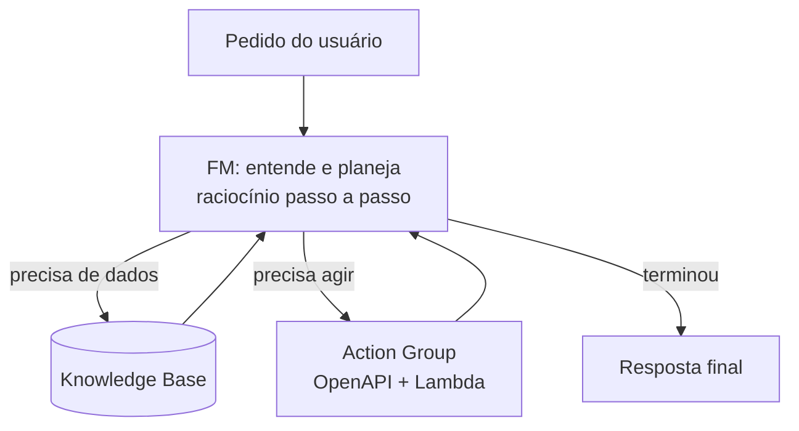

## Resumo

Um **agente** é uma aplicação de GenAI que **planeja e executa tarefas de várias etapas**: o FM entende o pedido, divide em passos, **chama APIs/ferramentas**, consulta **Knowledge Bases** e monta a resposta final. Na AWS isso é feito com **Agents for Amazon Bedrock** (o nome que aparece na prova) e, desde 2026, com o **Amazon Bedrock AgentCore**.

> [!info] Ideia central
> **FM sozinho** = só **responde**. **Agente** = **age**: consulta sistemas, executa ações (reservar, abrir chamado, consultar pedido) e decide o próximo passo.

## Como um agente funciona

Ciclo de orquestração (ideia do **ReAct**: raciocinar + agir):
1. **Entender** o pedido e as instruções do agente.
2. **Planejar** os passos (*chain-of-thought*).
3. **Agir**: chamar uma ferramenta ou buscar em uma Knowledge Base.
4. **Observar** o resultado e decidir o próximo passo.
5. Repetir até ter a **resposta final**.

## Componentes (Agents for Amazon Bedrock)

| Componente | Função |
|---|---|
| **Foundation Model** | O "cérebro": interpreta, planeja e decide |
| **Instruções** | O que o agente faz e como deve se comportar (prompt de sistema) |
| **Action groups** | Ações que o agente pode executar: **schema OpenAPI** (quais APIs existem) + **função AWS Lambda** (que executa) |
| **Knowledge Bases** | Fonte de informação para responder com RAG → [[Beadrock Rag - Kb]] |
| **Memória** | Lembra o contexto da conversa (inclusive entre sessões) |
| **Guardrails** | Limites de segurança → [[Bedrock Guardrail]] |
| **Trace** | Mostra **cada passo do raciocínio** (útil para depurar e para transparência) |
| **Return of control** | O agente pausa e devolve o controle à aplicação (ex.: pedir **confirmação humana**) |
| **Code interpreter** | Executa código num ambiente isolado (cálculos, gráficos) |
| **Multi-agent collaboration** | Um agente **supervisor** distribui o trabalho entre agentes especialistas |

## Novidade de 2026: Bedrock AgentCore

> [!warning] Atualização importante (fora do guia da prova)
> Desde **30/07/2026**, o recurso original passou a se chamar **Amazon Bedrock Agents Classic** e entrou em **modo de manutenção**: contas novas não criam mais agentes nele. O sucessor é o **Amazon Bedrock AgentCore**. **Knowledge Bases e Guardrails não mudam.**
> Na prova (guia v1.4) o nome continua **"Agents for Amazon Bedrock"**: responda pelo **conceito**.

| Agents Classic | Equivalente no AgentCore |
|---|---|
| Orquestração gerenciada | **Harness** gerenciado (você declara modelo, ferramentas e instruções) |
| Action groups (OpenAPI + Lambda) | Ferramentas via **AgentCore Gateway** (expostas como ferramentas **MCP**) |
| Knowledge Base no agente | Knowledge Base acessada pelo Gateway |
| Memória da sessão | **AgentCore Memory** (curto e longo prazo) |
| Code interpreter | **AgentCore Code Interpreter** |
| Trace | Rastreamento completo (**observability**) |

O AgentCore também roda agentes escritos em **qualquer framework** (Strands, LangChain e outros) e com modelos de **fora do Bedrock**.

## Quando usar um agente

| Cenário | Solução |
|---|---|
| Responder perguntas sobre documentos | **Knowledge Base (RAG)** — não precisa de agente |
| Tarefa com **várias etapas** que **consulta e altera sistemas** (ex.: "remarque meu voo e envie o recibo") | **Agente** |
| Fluxo **fixo e previsível** de prompts | **Bedrock Flows** (encadeamento) → [[Prompt na AWS]] |
| Assistente pronto para funcionários, sem construir nada | **Amazon Q Business** |

> [!tip] Palavras-chave na questão
> "**várias etapas**", "**chamar APIs**", "**executar ações**", "**orquestrar**", "**automatizar tarefas**" → **Agents for Amazon Bedrock**.

## Exemplo para Associação Mental

**O Assistente de Viagem.** Você diz: "quero ir a Lisboa na sexta, até R$ 4 mil". O **agente** (o assistente) **pensa** nos passos, **consulta** o sistema de voos (action group), **lê** a política de viagens da empresa (Knowledge Base), **pede sua confirmação** (return of control) e só então **reserva**. Um FM sozinho só diria "boa ideia, Lisboa é linda".

---
Índice: [[Índice - Bedrock]] · Anterior: [[Beadrock Rag - Kb]] · Próximo: [[Bedrock Guardrail]]

Fontes: [How Amazon Bedrock Agents works](https://docs.aws.amazon.com/bedrock/latest/userguide/agents-how.html) · [Amazon Bedrock Agents Classic maintenance mode](https://docs.aws.amazon.com/bedrock/latest/userguide/agents-classic-maintenance-mode.html)
