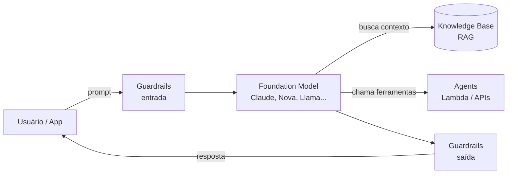

## Resumo

Ponto de partida para estudar o **Amazon Bedrock**, o serviço mais cobrado no AI Practitioner. Aparece nos Domínios 2, 3, 4 e 5 (juntos, mais de **75% da prova**). Esta nota dá a visão geral do serviço e aponta para as notas de cada recurso.

> [!info] Ideia central
> **Amazon Bedrock** = serviço **totalmente gerenciado e serverless** que dá acesso, **por uma única API**, a dezenas de **Foundation Models** (FMs) de vários fornecedores. Você **não gerencia servidores** nem treina modelos do zero e paga pelo uso.

## O que é o Amazon Bedrock

- Acesso a **100+ modelos** de **vários fornecedores** (Amazon, Anthropic, Meta, Mistral, Cohere, AI21 Labs, Stability AI, DeepSeek, OpenAI, Qwen e outros) pela **mesma API**.
- **Serverless**: sem instâncias para escolher, escalar ou corrigir.
- Ferramentas prontas para montar aplicações de GenAI: **RAG**, **agentes**, **guardrails**, **avaliação**, **customização** e **gestão de prompts**.
- **Seus dados ficam privados**: não são usados para treinar os modelos base e **não são compartilhados** com os fornecedores dos modelos.

## Mapa do Bedrock

| Recurso | Para que serve | Nota |
|---|---|---|
| **Model catalog / Playgrounds** | Escolher e testar FMs sem código | [[Fondation Model]] |
| **Model customization** | Fine-tuning, pré-treino contínuo, destilação, import de modelo | [[Fondation Model]] |
| **Model Evaluation** | Comparar modelos (automática, humana, LLM-as-a-judge) | [[Fondation Model]] |
| **Inferência e preços** | On-demand, batch, provisioned throughput, tiers | [[ML Inference]] |
| **Knowledge Bases** | **RAG** gerenciado com seus documentos | [[Beadrock Rag - Kb]] |
| **Agents / AgentCore** | Tarefas de várias etapas que chamam APIs | [[Bedrock Agents]] |
| **Guardrails** | Filtrar conteúdo nocivo, PII, tópicos, alucinação | [[Bedrock Guardrail]] |
| **Prompt Management / Flows** | Versionar prompts e encadear etapas | [[Prompt na AWS]] |
| **PartyRock** | Playground gratuito para criar apps de GenAI sem código | [[Prompt na AWS]] |

## Bedrock x SageMaker x JumpStart x Amazon Q

| Serviço | Quando escolher | Palavra-chave na questão |
|---|---|---|
| **Amazon Bedrock** | Usar FMs **por API**, sem gerenciar infraestrutura | "serverless", "menor esforço operacional", "vários FMs" |
| **SageMaker JumpStart** | Implantar/ajustar modelos pré-treinados com **controle da infraestrutura** (você escolhe as instâncias) | "controle", "instância", "hub de modelos" |
| **Amazon SageMaker AI** | **Construir, treinar e implantar** seus próprios modelos de ML | "treinar modelo próprio", "pipeline de ML" |
| **Amazon Q** | **Assistente pronto** (Q Business para dados da empresa, Q Developer para código) | "assistente pronto", "sem construir" |
| **PartyRock** | Aprender e experimentar GenAI **de graça e sem conta AWS** | "playground", "sem código" |

## Segurança e governança no Bedrock (Domínio 5)

| Preocupação | Como o Bedrock resolve |
|---|---|
| Privacidade dos dados | Prompts e respostas **não treinam** os modelos base nem vão para os fornecedores |
| Controle de acesso | **IAM** (políticas por modelo, por ação) |
| Criptografia | **Em trânsito (TLS)** e **em repouso**, com chaves do **AWS KMS** (inclusive chave do cliente) |
| Rede privada | **AWS PrivateLink / VPC endpoints**: o tráfego não passa pela internet pública |
| Auditoria | **CloudTrail** registra as chamadas de API |
| Monitoramento | **CloudWatch**: métricas (tokens, latência, erros) e *model invocation logging* |
| Conteúdo nocivo | **Guardrails** → [[Bedrock Guardrail]] |
| Compliance | Programas como ISO, SOC, HIPAA elegível, GDPR (relatórios no **AWS Artifact**) |

> [!tip] Dica para lembrar
> "**Os dados enviados ao Bedrock são usados para treinar o modelo?**" → **Não.** Essa é uma pegadinha clássica.

## Ordem de estudo sugerida

1. [[Fondation Model]]: o que é um FM, como escolher, customizar e avaliar.
2. [[ML Inference]]: como o modelo é chamado e quanto custa.
3. [[Beadrock Rag - Kb]]: RAG e Knowledge Bases.
4. [[Bedrock Agents]]: agentes e AgentCore.
5. [[Bedrock Guardrail]]: segurança das respostas.
6. ✅ [[Teste - Bedrock]]: questões no estilo da prova.

🎥 Vídeos em português sobre cada recurso: [[Vídeos de Estudo - YouTube#4. Amazon Bedrock por tema]]

## Exemplo para Associação Mental

**O Shopping de Modelos.** O **Bedrock** é um shopping onde cada loja é um fornecedor de modelos e você paga só o que consome. A **Knowledge Base** é o seu estoque particular, que o vendedor consulta antes de responder. O **Agent** é o *personal shopper* que vai em várias lojas e faz pedidos por você. O **Guardrail** é o segurança na porta, que revista quem entra (prompt) e o que sai (resposta).

---
Início: [[00 - Início - Guia do Exame]] · Roadmap: [[Road Map]] · Próximo: [[Fondation Model]]

Fontes: [What is Amazon Bedrock](https://docs.aws.amazon.com/bedrock/latest/userguide/what-is-bedrock.html) · [Amazon Bedrock Pricing](https://aws.amazon.com/bedrock/pricing/) · [Security best practices – Bedrock](https://aws.amazon.com/blogs/machine-learning/security-best-practices-to-consider-while-fine-tuning-models-in-amazon-bedrock/)
