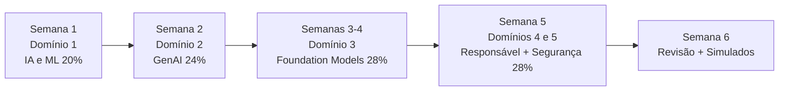

## Resumo

Plano de estudo em **6 semanas** (cerca de 1h por dia), ordenado do básico ao avançado e **dando mais tempo aos domínios de maior peso**. Se tiver menos tempo, comprima mantendo a ordem e a proporção.

> [!info] Ideia central
> **Fundamentos → GenAI → Foundation Models (maior peso) → Responsável → Segurança → Revisão e simulados.**

## Visão geral

| Fase | Semana | Foco | Peso na prova | Nota |
|---|---|---|---|---|
| 0 | Dia 1 | Entender o exame | — | [[01 - Visão Geral do Exame]] |
| 1 | 1 | Fundamentos de IA e ML | 20% | [[02 - Domínio 1 - Fundamentos de IA e ML]] |
| 2 | 2 | Fundamentos de IA Generativa | 24% | [[03 - Domínio 2 - Fundamentos de IA Generativa]] |
| 3 | 3–4 | Aplicações de Foundation Models | **28%** | [[04 - Domínio 3 - Aplicações de Foundation Models]] |
| 4 | 5 (1ª metade) | IA Responsável | 14% | [[05 - Domínio 4 - Diretrizes para IA Responsável]] |
| 5 | 5 (2ª metade) | Segurança, Compliance e Governança | 14% | [[06 - Domínio 5 - Segurança, Compliance e Governança]] |
| 6 | 6 | Revisão, serviços e simulados | — | [[07 - Serviços AWS do Exame]] · [[09 - Checklist de Estudo]] |

## Fase 0 — Preparação (Dia 1)

- [x] Ler a [[01 - Visão Geral do Exame]] (formato, nota mínima 700, pesos).
- [ ] Criar conta no **AWS Skill Builder** e conhecer o *Official Practice Question Set* (gratuito).
- [ ] Fazer um diagnóstico rápido: tentar responder as autoavaliações dos domínios sem estudar.

## Fase 1 — Domínio 1: Fundamentos de IA e ML (Semana 1)

| Dia | Estudo |
|---|---|
| 1 | IA x ML x DL x GenAI · [[O que é Inteligência Artificial]] · [[O que é  Machine Learn]] · [[O que é  Deep Learn]] |
| 2 | Tipos de aprendizado · [[Aprendizado Supervisionado]] · [[Aprendizado Não Supervisionado]] · [[Aprendizado por Reforço]] |
| 3 | Tipos de dados, inferência batch x tempo real, regressão x classificação x clusterização |
| 4 | Serviços de IA prontos: Rekognition, Comprehend, Transcribe, Translate, Polly, Lex, Textract, Kendra, Personalize |
| 5 | Pipeline de ML + SageMaker (Data Wrangler, Feature Store, Model Monitor) + MLOps |
| 6 | Métricas: acurácia, precisão, recall, F1, AUC + métricas de negócio (ROI) |
| 7 | Revisão + autoavaliação do Domínio 1 |

## Fase 2 — Domínio 2: Fundamentos de GenAI (Semana 2)

| Dia | Estudo |
|---|---|
| 1 | [[O que é  Generative IA]] · tokens, foundation models, LLMs |
| 2 | Transformers, embeddings, vetores, chunking, multimodal, difusão |
| 3 | Casos de uso de GenAI + ciclo de vida de um FM |
| 4 | Vantagens x limitações (alucinação, não determinismo) e escolha de modelo |
| 5 | Amazon Bedrock, SageMaker JumpStart, PartyRock, Amazon Q |
| 6 | Custos: preço por token, on-demand x batch x provisioned throughput |
| 7 | Revisão + autoavaliação do Domínio 2 |

## Fase 3 — Domínio 3: Foundation Models (Semanas 3 e 4) ⭐

| Dia | Estudo |
|---|---|
| 1 | Critérios de escolha de modelo + [[Parâmetros de Inferência]] |
| 2 | **RAG** e Bedrock Knowledge Bases |
| 3 | Bancos vetoriais: OpenSearch, Aurora/RDS pgvector, Neptune, DocumentDB |
| 4 | Custos de customização: prompt → RAG → fine-tuning → pré-treino |
| 5 | Agents for Amazon Bedrock |
| 6–7 | Revisão da semana |
| 8 | [[O que é um Prompt]] · [[Anatomia de um Prompt]] |
| 9 | [[Tipos de Prompt]] · [[Boa Praticas]] |
| 10 | [[Riscos e Segurança em Prompts]] · [[Prompt na AWS]] |
| 11 | Pré-treino, fine-tuning, instruction tuning, transfer learning, pré-treino contínuo, RLHF |
| 12 | Avaliação: humana, benchmarks, ROUGE, BLEU, BERTScore, Bedrock Model Evaluation |
| 13 | [[Perguntas de Revisão - Prompt]] |
| 14 | Revisão + autoavaliação do Domínio 3 |

## Fase 4 e 5 — Domínios 4 e 5 (Semana 5)

| Dia | Estudo |
|---|---|
| 1 | Dimensões de IA responsável, riscos legais, datasets balanceados |
| 2 | Viés x variância, SageMaker Clarify, Model Monitor, A2I, Guardrails |
| 3 | Transparência x explicabilidade, Model Cards, design centrado no humano |
| 4 | Segurança: IAM, KMS, Macie, PrivateLink, responsabilidade compartilhada, linhagem de dados |
| 5 | Governança: CloudTrail, Config, Audit Manager, Artifact, Trusted Advisor, Inspector |
| 6 | Generative AI Security Scoping Matrix, ISO/SOC, residência e retenção de dados |
| 7 | Revisão + autoavaliação dos Domínios 4 e 5 |

## Fase 6 — Revisão final (Semana 6)

| Dia | Atividade |
|---|---|
| 1 | Revisar [[07 - Serviços AWS do Exame]] (serviço ↔ caso de uso) |
| 2 | Simulado completo nº 1 (65 questões, 90 min) |
| 3 | Revisar erros, voltando às notas do domínio correspondente |
| 4 | Simulado completo nº 2 |
| 5 | Revisar erros + [[10 - Glossário do Exame]] |
| 6 | Passar o [[09 - Checklist de Estudo]] inteiro — o que não estiver ✅, revisar |
| 7 | Descanso leve + revisão relâmpago do [[00 - Início - Guia do Exame]] |

> [!tip] Estratégia na prova
> - Leia a **última frase** da questão primeiro (o que ela pede de fato).
> - Procure palavras-chave: "**menor custo**", "**menor esforço operacional**", "**sem treinar**", "**dados atualizados**".
> - Elimine alternativas com serviços **fora do escopo**.
> - **Nunca deixe em branco** — não há penalidade por chutar.
> - Marque as questões em dúvida para revisar no fim.

## Recursos oficiais recomendados

- **AWS Skill Builder**: *Exam Prep Standard Course: AWS Certified AI Practitioner* e *Official Practice Question Set*.
- **Amazon Bedrock User Guide** (seções de Knowledge Bases, Agents, Guardrails e Prompt Engineering).
- **PartyRock** (partyrock.aws) para praticar prompts na mão.

---
Início: [[00 - Início - Guia do Exame]] · Anterior: [[07 - Serviços AWS do Exame]] · Próximo: [[09 - Checklist de Estudo]]
