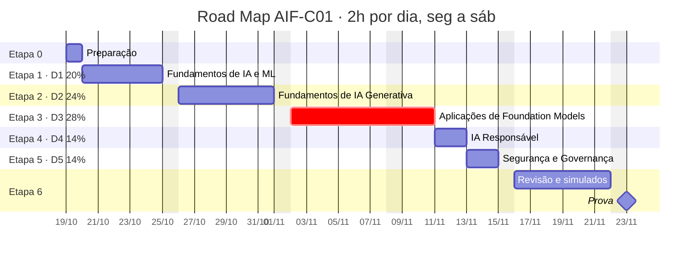

## Resumo

Plano de estudo para a **AWS Certified AI Practitioner (AIF-C01)** com **2 horas por dia, de segunda a sábado** (domingo livre). São **6 etapas em 5 semanas**: 30 dias de estudo, **60 horas** no total. A ordem segue o [[08 - Roadmap de Estudo]], ajustada a esse ritmo, e os domínios que valem mais na prova recebem mais horas.

> [!info] Ideia central
> **Preparação → Fundamentos (D1) → GenAI (D2) → Foundation Models (D3, o de maior peso) → IA Responsável (D4) → Segurança (D5) → Revisão e simulados → Prova.**
> Início: **seg 19/10/2026** · Fim do plano: **sáb 21/11/2026** · Prova sugerida: **seg 23/11 ou ter 24/11**.

## Visão geral

| Etapa | Período | Dias | Horas | Foco | Peso na prova |
|---|---|---|---|---|---|
| 0 | 19/10 | ½ | 1h | Entender o exame | — |
| 1 | 19/10 – 24/10 | 5½ | 11h | [[02 - Domínio 1 - Fundamentos de IA e ML\|D1 · Fundamentos de IA e ML]] | 20% |
| 2 | 26/10 – 31/10 | 6 | 12h | [[03 - Domínio 2 - Fundamentos de IA Generativa\|D2 · Fundamentos de IA Generativa]] | 24% |
| 3 | 02/11 – 10/11 | 8 | **16h** | [[04 - Domínio 3 - Aplicações de Foundation Models\|D3 · Aplicações de Foundation Models]] ⭐ | **28%** |
| 4 | 11/11 – 12/11 | 2 | 4h | [[05 - Domínio 4 - Diretrizes para IA Responsável\|D4 · IA Responsável]] | 14% |
| 5 | 13/11 – 14/11 | 2 | 4h | [[06 - Domínio 5 - Segurança, Compliance e Governança\|D5 · Segurança e Governança]] | 14% |
| 6 | 16/11 – 21/11 | 6 | 12h | Revisão, serviços e simulados | — |

## Como usar as 2 horas do dia

| Tempo | Bloco | O que fazer |
|---|---|---|
| 0:00 – 0:10 | 🔁 Aquecimento | Tentar lembrar, sem consultar, o que foi estudado no dia anterior |
| 0:10 – 0:55 | 📖 Bloco 1: teoria | Ler a nota do domínio e as notas de conteúdo ligadas a ela |
| 0:55 – 1:05 | ☕ Pausa | Levantar e sair da tela |
| 1:05 – 1:45 | 🛠️ Bloco 2: prática | Questões, console AWS ou PartyRock, comparar serviços |
| 1:45 – 2:00 | ✅ Fechamento | Resumo de 5 linhas + marcar o [[09 - Checklist de Estudo]] |

> [!tip] Regras do plano
> - **Sábado é dia de revisão**: fecha a semana com uma autoavaliação.
> - **Domingo é livre.** Se perder um dia, use o domingo para repor ou junte a matéria com a revisão de sábado.
> - Só marque um item no checklist quando conseguir **explicar em voz alta, sem consultar**.
> - **Feriados no meio do plano:** 02/11 (Finados) e 20/11 (Consciência Negra). Se forem folga, estude normalmente ou reponha no domingo.

---

## Semana 1 · Etapas 0 e 1 (19/10 – 24/10)

> [!example] Meta da semana
> Dominar o **vocabulário básico** de IA/ML e associar cada **serviço de IA pronto** ao seu caso de uso.

| Dia | Data | Etapa | Bloco 1: teoria | Bloco 2: prática |
|---|---|---|---|---|
| Seg | 19/10 | 0 + 1 | [[01 - Visão Geral do Exame]]: formato, pesos, nota 700 | Criar conta no **AWS Skill Builder** + [[O que é Inteligência Artificial]] |
| Ter | 20/10 | 1 | [[O que é  Machine Learn]] · [[O que é  Deep Learn]] · IA x ML x DL | [[Aprendizado Supervisionado]] · [[Aprendizado Não Supervisionado]] · [[Aprendizado por Reforço]] |
| Qua | 21/10 | 1 | [[Diferenças entre os Tipos de Aprendizado]] · [[Tipos de Algoritimos de Machine Learn]] | Tipos de dados · inferência batch x tempo real · regressão x classificação x clusterização · quando **não** usar IA |
| Qui | 22/10 | 1 | Serviços prontos: Rekognition, Comprehend, Transcribe, Translate, Polly, Lex | Textract, Kendra, Personalize, Fraud Detector · [[Comparação Geral e Casos de Uso]] |
| Sex | 23/10 | 1 | Ciclo de vida de ML · SageMaker (Data Wrangler, Feature Store, Model Monitor) · MLOps | Métricas técnicas (acurácia, precisão, recall, F1, AUC) e de negócio (ROI, custo por usuário) |
| Sáb | 24/10 | 1 | 🔁 Revisão do [[02 - Domínio 1 - Fundamentos de IA e ML]] | Autoavaliação do D1 + checklist do D1 |

**Progresso:**
- [ ] Seg 19/10
- [ ] Ter 20/10
- [ ] Qua 21/10
- [ ] Qui 22/10
- [ ] Sex 23/10
- [ ] Sáb 24/10 · autoavaliação D1: ___%

## Semana 2 · Etapa 2 (26/10 – 31/10)

> [!example] Meta da semana
> Entender **como funciona a IA Generativa** e saber diferenciar **Bedrock, JumpStart, PartyRock e Amazon Q**.

| Dia | Data | Bloco 1: teoria | Bloco 2: prática |
|---|---|---|---|
| Seg | 26/10 | [[O que é  Generative IA]] · tokens, foundation models, LLMs | Transformers: a ideia geral, sem matemática |
| Ter | 27/10 | Embeddings, vetores, chunking | Modelos multimodais e de difusão |
| Qua | 28/10 | Casos de uso de GenAI + ciclo de vida de um FM | Vantagens x limitações: alucinação, não determinismo, interpretabilidade |
| Qui | 29/10 | Fatores de escolha de modelo + métricas de negócio (conversão, ARPU, CLV) | **Amazon Bedrock**: abrir o console e testar um modelo no *playground* |
| Sex | 30/10 | SageMaker JumpStart · PartyRock · Amazon Q | Custos: preço por token, on-demand x batch x *provisioned throughput* |
| Sáb | 31/10 | 🔁 Revisão do [[03 - Domínio 2 - Fundamentos de IA Generativa]] | Autoavaliação do D2 + checklist do D2 |

**Progresso:**
- [ ] Seg 26/10
- [ ] Ter 27/10
- [ ] Qua 28/10
- [ ] Qui 29/10
- [ ] Sex 30/10
- [ ] Sáb 31/10 · autoavaliação D2: ___%

## Semanas 3 e 4 · Etapa 3 (02/11 – 10/11) ⭐

> [!warning] Etapa mais importante
> O D3 vale **28%** e, somado ao D2, passa da **metade da prova**. Por isso esta etapa tem **8 dias (16h)**.

| Dia | Data | Bloco 1: teoria | Bloco 2: prática |
|---|---|---|---|
| Seg | 02/11 | Critérios de escolha de modelo (custo, latência, modalidade, idiomas, tamanho) | [[Parâmetros de Inferência]]: testar temperatura e top-p no PartyRock ou no Bedrock |
| Ter | 03/11 | **RAG**: o que é e quando usar | **Bedrock Knowledge Bases** |
| Qua | 04/11 | Bancos vetoriais: OpenSearch, Aurora/RDS pgvector, Neptune, DocumentDB | Custos de customização: prompt → RAG → fine-tuning → pré-treino |
| Qui | 05/11 | **Agents for Amazon Bedrock** | [[Índice - Prompt]] · [[O que é um Prompt]] · [[Anatomia de um Prompt]] |
| Sex | 06/11 | [[Tipos de Prompt]]: zero-shot, few-shot, chain-of-thought, templates | [[Boa Praticas]]: praticar prompts no PartyRock |
| Sáb | 07/11 | [[Riscos e Segurança em Prompts]] · [[Prompt na AWS]] · [[Bedrock Guardrail]] | 🔁 [[Perguntas de Revisão - Prompt]] + revisão da semana |
| Seg | 09/11 | Pré-treino, fine-tuning, pré-treino contínuo, instruction tuning, transfer learning, RLHF | Avaliação: humana x benchmarks · ROUGE, BLEU, BERTScore · Bedrock Model Evaluation |
| Ter | 10/11 | 🔁 Revisão do [[04 - Domínio 3 - Aplicações de Foundation Models]] | Autoavaliação do D3 + checklist do D3 |

**Progresso:**
- [ ] Seg 02/11
- [ ] Ter 03/11
- [ ] Qua 04/11
- [ ] Qui 05/11
- [ ] Sex 06/11
- [ ] Sáb 07/11
- [ ] Seg 09/11
- [ ] Ter 10/11 · autoavaliação D3: ___%

## Semana 4 · Etapas 4 e 5 (11/11 – 14/11)

> [!example] Meta da semana
> Saber **qual serviço resolve cada problema** de IA responsável, segurança e governança. É a parte mais "decoreba" da prova.

| Dia | Data | Etapa | Bloco 1: teoria | Bloco 2: prática |
|---|---|---|---|---|
| Qua | 11/11 | 4 | Dimensões de IA responsável · riscos legais · datasets balanceados · viés x variância | Guardrails for Bedrock · SageMaker Clarify · Model Monitor · Amazon A2I |
| Qui | 12/11 | 4 | Transparência x explicabilidade · SageMaker Model Cards · licenças open source · design centrado no humano | 🔁 Revisão e autoavaliação do [[05 - Domínio 4 - Diretrizes para IA Responsável]] |
| Sex | 13/11 | 5 | IAM · KMS · Macie · PrivateLink · responsabilidade compartilhada aplicada à IA | Linhagem de dados · engenharia de dados segura · prompt injection · criptografia em repouso e em trânsito |
| Sáb | 14/11 | 5 | CloudTrail · Config · Audit Manager · Artifact · Trusted Advisor · Inspector · Generative AI Security Scoping Matrix · ISO/SOC | 🔁 Revisão e autoavaliação do [[06 - Domínio 5 - Segurança, Compliance e Governança]] |

**Progresso:**
- [ ] Qua 11/11
- [ ] Qui 12/11 · autoavaliação D4: ___%
- [ ] Sex 13/11
- [ ] Sáb 14/11 · autoavaliação D5: ___%

## Semana 5 · Etapa 6: Revisão e simulados (16/11 – 21/11)

> [!example] Meta da semana
> Treinar no **formato real da prova** (65 questões em 90 min) e fechar as lacunas a partir dos erros.

| Dia | Data | Bloco 1 | Bloco 2 |
|---|---|---|---|
| Seg | 16/11 | [[07 - Serviços AWS do Exame]]: serviço ↔ caso de uso | Serviços **fora do escopo** + [[10 - Glossário do Exame]] |
| Ter | 17/11 | 📝 **Simulado nº 1** (65 questões, 90 min) | Corrigir e anotar os erros por domínio |
| Qua | 18/11 | Estudar os erros do simulado nº 1 voltando às notas do domínio | Refazer só as questões erradas |
| Qui | 19/11 | 📝 **Simulado nº 2** (*Official Practice Question Set*, Skill Builder) | Corrigir e anotar os erros por domínio |
| Sex | 20/11 | Estudar os erros do simulado nº 2 | Passar o [[09 - Checklist de Estudo]] inteiro: o que não estiver ✅, revisar |
| Sáb | 21/11 | 🔁 Revisão relâmpago: [[00 - Início - Guia do Exame]] + itens ⭐⭐⭐ do checklist | Descanso leve. Confirmar data, horário e documentos da prova |

**Progresso:**
- [ ] Seg 16/11
- [ ] Ter 17/11 · simulado nº 1: ___%
- [ ] Qua 18/11
- [ ] Qui 19/11 · simulado nº 2: ___%
- [ ] Sex 20/11
- [ ] Sáb 21/11

> [!success] Critério para ir à prova
> Acertar **≥ 80%** em pelo menos um simulado e ter **todos os itens ⭐⭐⭐** do [[09 - Checklist de Estudo]] marcados. Se não chegar lá, adie a prova 1 semana e repita a Etapa 6 focando nos domínios mais fracos.

---

## Acompanhamento semanal

| Semana | Etapas | Horas previstas | Horas feitas | Autoavaliação (%) | Domínio mais fraco |
|---|---|---|---|---|---|
| 1 | 0 · 1 | 12h | | | |
| 2 | 2 | 12h | | | |
| 3 | 3 | 12h | | | |
| 4 | 3 · 4 · 5 | 12h | | | |
| 5 | 6 | 12h | | | |
| **Total** | | **60h** | | | |

## Recursos

- **AWS Skill Builder**: *Exam Prep Standard Course: AWS Certified AI Practitioner* e *Official Practice Question Set* (gratuito).
- **Amazon Bedrock User Guide**: Knowledge Bases, Agents, Guardrails e Prompt Engineering.
- **PartyRock** (partyrock.aws): para praticar prompts e parâmetros na mão.

> [!tip] Estratégia na prova
> Leia a **última frase** da questão primeiro · procure palavras-chave ("**menor custo**", "**menor esforço operacional**", "**sem treinar**", "**dados atualizados**") · elimine serviços fora do escopo · **nunca deixe em branco**.

---
Início: [[00 - Início - Guia do Exame]] · Plano original: [[08 - Roadmap de Estudo]] · Progresso: [[09 - Checklist de Estudo]]
