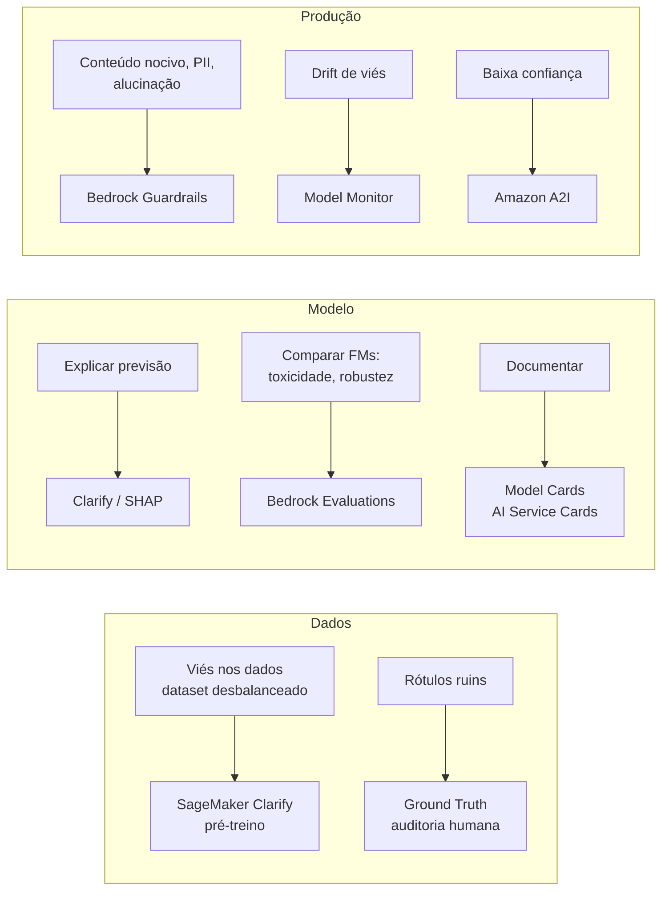

## Resumo

Ponto de partida para o **Domínio 4 — Diretrizes para IA Responsável** do AI Practitioner (AIF-C01). Vale **14% da prova** (cerca de **7 das 50 questões pontuadas**). Aqui está **o que o guia oficial exige**, os **serviços AWS ligados** a cada objetivo e a ordem de estudo.

> [!info] Ideia central
> IA responsável = construir IA **justa, segura, verdadeira, transparente e explicável**, com **humanos supervisionando** e **ferramentas medindo** viés e qualidade.
> Na prova, quase nunca cai "defina X". Cai **"qual ferramenta resolve este cenário?"**.

## Ordem de estudo

| # | Nota | Para que serve |
|---|---|---|
| 1 | [[05 - Domínio 4 - Diretrizes para IA Responsável]] | O guia do domínio, resumido |
| 2 | [[IA Responsável - Conceitos e Riscos]] | Tarefa 4.1: dimensões, riscos legais, datasets, viés x variância, sustentabilidade |
| 3 | [[IA Responsável - Transparência e Explicabilidade]] | Tarefa 4.2: transparente x caixa-preta, trade-offs, design centrado no humano |
| 4 | [[IA Responsável - Serviços AWS]] | Guardrails, Clarify, Model Monitor, A2I, Ground Truth, Model Cards, Bedrock Evaluations, AI Service Cards |
| 5 | [[IA Responsável - Formulário de Respostas]] | Simulado com 30 questões (sempre limpo) |

## O que a prova exige (guia oficial, versão 1.4)

### Tarefa 4.1 — Explicar o desenvolvimento de sistemas de IA responsáveis

| # | Objetivo do guia | Em português | Onde estudar |
|---|---|---|---|
| a | *Identify features of responsible AI* (bias, fairness, inclusivity, robustness, safety, veracity) | Saber as **dimensões** de IA responsável | [[IA Responsável - Conceitos e Riscos#1. As dimensões de IA responsável]] |
| b | *Use tools to identify features of responsible AI* (ex.: **Amazon Bedrock Guardrails**) | Saber **qual ferramenta** aplica cada dimensão | [[IA Responsável - Serviços AWS]] · [[Bedrock Guardrail]] |
| c | *Responsible practices to select a model* (environmental considerations, sustainability) | Escolher modelo pensando em **custo ambiental** | [[IA Responsável - Conceitos e Riscos#5. Escolha responsável do modelo (sustentabilidade)]] |
| d | *Legal risks of GenAI* (IP infringement, biased outputs, loss of customer trust, end user risk, hallucinations) | Os **5 riscos legais** da GenAI | [[IA Responsável - Conceitos e Riscos#2. Riscos legais da IA generativa]] |
| e | *Characteristics of datasets* (inclusivity, diversity, curated sources, balanced) | Como é um **bom dataset** | [[IA Responsável - Conceitos e Riscos#3. Características de um bom dataset]] |
| f | *Effects of bias and variance* (demographic groups, inaccuracy, overfitting, underfitting) | **Viés x variância** e o efeito em grupos | [[IA Responsável - Conceitos e Riscos#4. Viés x variância]] |
| g | *Tools to detect and monitor bias, trustworthiness, truthfulness* (label quality, human audits, subgroup analysis) | **Como detectar** viés e falta de veracidade | [[IA Responsável - Serviços AWS#Detectar e monitorar viés]] |

### Tarefa 4.2 — Reconhecer a importância de modelos transparentes e explicáveis

| # | Objetivo do guia | Em português | Onde estudar |
|---|---|---|---|
| a | *Differences between transparent/explainable models and those that are not* | Modelo **transparente** x **caixa-preta** | [[IA Responsável - Transparência e Explicabilidade#1. Transparente x explicável x caixa-preta]] |
| b | *Tools to identify transparent and explainable models* (**SageMaker Model Cards**, **Bedrock Model Evaluations**, open source models, data, licensing) | Ferramentas de **documentação e avaliação** | [[IA Responsável - Serviços AWS#Transparência e avaliação]] |
| c | *Tradeoffs between model safety and transparency* (interpretability and performance) | **Interpretabilidade x desempenho** e **segurança x transparência** | [[IA Responsável - Transparência e Explicabilidade#3. Os trade-offs]] |
| d | *Principles of human-centered design for explainable AI* (user feedback, AI decision transparency) | **Design centrado no humano** | [[IA Responsável - Transparência e Explicabilidade#4. Design centrado no humano]] |

> [!warning] Mudança no guia (atenção)
> A versão atual do guia **não cita mais nominalmente** SageMaker Clarify, Model Monitor e A2I no Domínio 4. Agora fala em **análise de qualidade de rótulos, auditorias humanas, análise por subgrupo** e acrescenta **Amazon Bedrock Model Evaluations**. Mesmo assim, **estude Clarify, Model Monitor e A2I**: continuam na lista de serviços do exame e aparecem nos simulados. Além disso, desde 2026 o **SageMaker Clarify não aceita novos clientes** (veja [[IA Responsável - Serviços AWS#SageMaker Clarify]]).

## Mapa: dimensão → serviço AWS

## Associação rápida (palavra-chave → resposta)

| Na questão aparece... | Resposta provável |
|---|---|
| "bloquear conteúdo nocivo", "tópicos proibidos", "mascarar PII", "reduzir alucinação no RAG" | **Amazon Bedrock Guardrails** |
| "detectar viés no dataset **antes de treinar**", "explicar quais **features** influenciaram", "SHAP" | **SageMaker Clarify** |
| "viés **mudando em produção**", "drift" | **SageMaker Model Monitor** |
| "**revisão humana** quando a confiança é baixa" | **Amazon A2I** |
| "**rotular** dados com humanos", "RLHF" | **SageMaker Ground Truth** |
| "documentar **seu** modelo: uso pretendido, riscos, métricas" | **SageMaker Model Cards** |
| "uso pretendido e limitações de um **serviço da AWS** (Rekognition, Nova...)" | **AWS AI Service Cards** |
| "comparar FMs em **toxicidade/robustez/acurácia**", "LLM-as-a-judge" | **Amazon Bedrock Evaluations** |
| "boas práticas / framework para **projetar** IA responsável" | **Well-Architected Responsible AI Lens** |

## Relacionadas
- [[Bedrock Guardrail]] · [[SageMaker - Models and Humans]] · [[SageMaker - Governança e Segurança]] · [[Amazon Augmented AI]]
- [[Riscos e Segurança em Prompts]] (prompt injection, jailbreak)
- [[06 - Domínio 5 - Segurança, Compliance e Governança]] (governança continua lá)

## Checklist

- [ ] Sei as 8 dimensões de IA responsável da AWS
- [ ] Sei os 5 riscos legais da GenAI e uma mitigação para cada
- [ ] Sei as 4 características de um bom dataset
- [ ] Relaciono alto viés → underfitting e alta variância → overfitting
- [ ] Sei práticas de escolha sustentável de modelo
- [ ] Sei para que servem Guardrails, Clarify, Model Monitor, A2I, Ground Truth
- [ ] Diferencio **Model Cards** (meu modelo) x **AI Service Cards** (serviços AWS)
- [ ] Sei os tipos de avaliação do Bedrock Evaluations
- [ ] Diferencio transparência x explicabilidade e sei os trade-offs
- [ ] Fiz o formulário e acertei 24+ de 30

---
Início: [[00 - Início - Guia do Exame]] · Guia do domínio: [[05 - Domínio 4 - Diretrizes para IA Responsável]] · Próximo: [[IA Responsável - Conceitos e Riscos]]

Fontes: [AIF-C01 Exam Guide – Domínio 4](https://docs.aws.amazon.com/aws-certification/latest/ai-practitioner-01/ai-practitioner-01-domain4.html) · [AWS Responsible AI](https://aws.amazon.com/ai/responsible-ai/)
