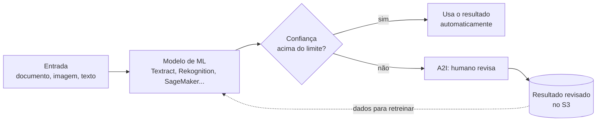

## Resumo

O **Amazon Augmented AI (Amazon A2I)** coloca **revisão humana** nas previsões de ML de um jeito simples. Quando o modelo **não tem confiança suficiente** (ou numa amostra aleatória para auditoria), o A2I envia o caso para **pessoas revisarem** antes de usar o resultado. Você não precisa construir sistema de revisão nem gerenciar revisores.

> [!info] Ideia central
> **Previsão de baixa confiança → humano revisa → resultado confiável.** É o conceito de ***human-in-the-loop***.
> 🔑 Palavras-chave na prova: "**revisão humana**", "**human-in-the-loop**", "**baixa confiança**", "**validar previsões**", "**auditoria de amostras**".

> [!warning] Status 2026: fechado para novos clientes
> O A2I (parte do SageMaker AI) entrou em **manutenção em 30/06/2026** e **não aceita novos clientes desde 30/07/2026**. Quem já usa continua normalmente. A página da AWS não indica um substituto direto.
> **Na prova** (guia v1.4), o A2I continua no escopo, ligado à **IA Responsável** (Domínio 4): o conceito de **humano no circuito** continua essencial.

## Ficha rápida

| Item | Detalhe |
|---|---|
| **Categoria** | Revisão humana de ML (*human-in-the-loop*) · IA Responsável |
| **Entrada** | Previsões de um modelo (Textract, Rekognition, SageMaker ou qualquer outro) |
| **Saída** | Resultado **revisado por humanos**, salvo no **S3** |
| **Precisa saber ML?** | Não |
| **Customização** | Regras de quando acionar o humano, modelos de tela de revisão e escolha da equipe revisora |
| **Modos** | Disparo por **limite de confiança** ou por **amostragem aleatória** |
| **Na prova** | Domínio 4 · Tarefa 4.1 · ⭐⭐⭐ |
| **Status 2026** | ⚠️ Sem novos clientes desde 30/07/2026 |

## Como funciona

| Conceito | O que é |
|---|---|
| **Human review workflow** (*flow definition*) | Define **quando** acionar o humano, **quem** revisa e **como** é a tela |
| **Human loop** | Cada **tarefa de revisão** enviada para as pessoas |
| **Worker task template** | A **tela** (HTML) que o revisor vê |
| **Força de trabalho** | **Amazon Mechanical Turk** (público), **equipe privada** (seus funcionários) ou **fornecedores** (AWS Marketplace) |

## Principais recursos

| Recurso | O que faz |
|---|---|
| **Integração pronta com Textract** | Humanos revisam **pares chave-valor** de formulários com baixa confiança |
| **Integração pronta com Rekognition** | Humanos revisam **moderação de imagens** duvidosas |
| **Tarefas personalizadas** | Funciona com **qualquer modelo**: SageMaker, Comprehend, Transcribe, Translate ou modelos fora da AWS |
| **Amostragem aleatória** | Envia uma **% das previsões** para auditoria contínua da qualidade |
| **Retroalimentação** | As respostas humanas viram **dados para retreinar** e melhorar o modelo |

## Casos de uso

| Cenário | Como o A2I ajuda |
|---|---|
| **Crédito / financiamento** | Formulário escaneado com letra ilegível → humano confere |
| **Moderação de conteúdo** | Imagem "talvez imprópria" → humano decide |
| **Saúde** | Decisões sensíveis passam por um especialista |
| **Auditoria de qualidade** | Revisar 5% das previsões para monitorar o modelo |

## Não confunda

| Serviço | Diferença |
|---|---|
| **SageMaker Ground Truth** | Humanos **rotulam dados ANTES** do treino (criar o dataset). O A2I revisa **previsões DEPOIS** do modelo em produção |
| **SageMaker Clarify** | Detecta **viés** e explica previsões automaticamente, **sem** humanos |
| **SageMaker Model Monitor** | Monitora **desvios** (*drift*) do modelo automaticamente |
| **Bedrock Model Evaluation (humana)** | Humanos **comparam modelos de GenAI** antes de escolher. O A2I revisa **previsões individuais** em produção |

> [!tip] Dica para lembrar
> **Ground Truth = antes** (rotular para treinar). **A2I = depois** (revisar o que o modelo previu).

> [!warning] Pegadinhas de prova
> - "Enviar previsões de **baixa confiança** para **revisão humana**" → **A2I**.
> - "**Rotular** imagens para treinar um modelo" → **Ground Truth**, não A2I.
> - "Garantir **supervisão humana** em decisões sensíveis (IA Responsável)" → **A2I**.

## Exemplo para Associação Mental

**O Supervisor do Caixa.** O caixa (modelo) passa as compras sozinho. Quando aparece algo estranho, como um produto sem código ou um valor alto demais (**baixa confiança**), a luz acende e o **supervisor humano** vem conferir. De vez em quando o supervisor também **confere uma compra qualquer** (amostragem aleatória) só para garantir.

## 📝 Meu entendimento

> Implemente facilmente análise humana para previsões de ML

---
Resumo: [[Resumo]] · Anterior: [[Amazon Forecast]] · Próximo: [[Amazon SageMaker]]

Fontes: [Using Amazon Augmented AI for Human Review](https://docs.aws.amazon.com/sagemaker/latest/dg/a2i-use-augmented-ai-a2i-human-review-loops.html) · [Serviços em manutenção (AWS)](https://docs.aws.amazon.com/general/latest/gr/maintenance_services.html)
