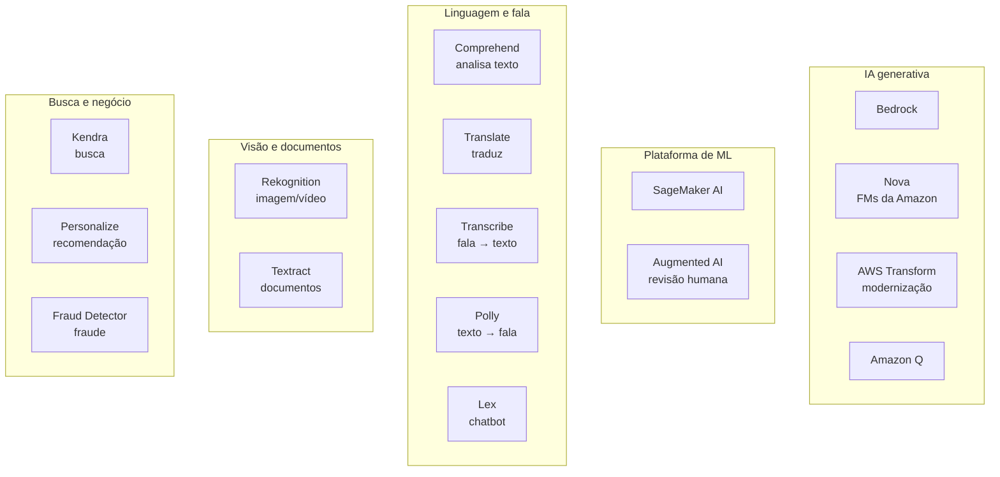

## Resumo

Visão geral dos **serviços de IA/ML da AWS** que estão no escopo da prova **AIF-C01**. Esta nota é o ponto de partida da pasta: mostra **o que cada serviço faz**, **como identificá-lo nas questões** e **quais confusões evitar**. Cada serviço tem uma nota própria com o mesmo modelo.

> [!info] Ideia central
> A prova quase sempre descreve um **problema** e pergunta **qual serviço resolve**. Descubra a **entrada** e a **saída** que o problema pede: **fala → texto** é Transcribe, **texto → fala** é Polly, **imagem → rótulos** é Rekognition, **documento → dados** é Textract.

## Mapa dos serviços

## Tabela mestre

| Serviço | Categoria | Entrada → Saída | Palavras-chave na prova | Prioridade | Status 2026 |
|---|---|---|---|---|---|
| [[Amazon Comprehend Medical]] | Linguagem (saúde) | Texto clínico → entidades médicas, PHI, códigos ICD-10 | anotações médicas, medicamentos e dosagens, PHI, HIPAA | ⭐⭐ | ✅ |
| [[Amazon Comprehend]] | Linguagem | Texto → insights (sentimento, entidades, PII) | sentimento, entidades, frases-chave, classificar texto | ⭐⭐⭐ | ✅ |
| [[Amazon Translate]] | Linguagem | Texto → texto em outro idioma | traduzir, multilíngue, terminologia | ⭐⭐⭐ | ✅ |
| [[Amazon Transcribe]] | Fala | Áudio → texto | transcrever, legendas, speech-to-text | ⭐⭐⭐ | ✅ |
| [[Amazon Polly]] | Fala | Texto → áudio | text-to-speech, voz natural, SSML | ⭐⭐⭐ | ✅ |
| [[Amazon Lex]] | Conversação | Fala/texto → diálogo + ação | chatbot, conversacional, Alexa, URA | ⭐⭐⭐ | ✅ |
| [[Amazon Rekognition]] | Visão | Imagem/vídeo → rótulos, rostos, moderação | rosto, objeto, moderação de imagem, celebridade | ⭐⭐⭐ | ✅ |
| [[Amazon Textract]] | Documentos | PDF/imagem → texto, formulários, tabelas | OCR, formulários, notas fiscais | ⭐⭐ | ✅ |
| [[Amazon Kendra]] | Busca | Pergunta → resposta nos documentos | busca corporativa, enterprise search | ⭐⭐ | ⚠️ manutenção |
| [[Amazon Personalize]] | Recomendação | Interações → itens recomendados | recomendação, personalização | ⭐⭐ | ✅ |
| [[Amazon Fraud Detector]] | Fraude | Evento → pontuação de risco | fraude online, pagamento fraudulento | ⭐⭐ | ⚠️ sem novos clientes |
| [[Amazon Augmented AI]] | Revisão humana | Previsão duvidosa → revisão humana | human-in-the-loop, baixa confiança | ⭐⭐⭐ | ⚠️ sem novos clientes |
| [[Amazon SageMaker]] | Plataforma de ML | Dados → modelo próprio em produção | treinar modelo, MLOps, Clarify, Canvas | ⭐⭐⭐ | ✅ (alguns recursos ⚠️) |
| [[Amazon Bedrock]] | IA generativa | Prompt → conteúdo gerado | foundation model, RAG, guardrails, agentes | ⭐⭐⭐ | ✅ |
| [[Amazon Nova]] 🆕 | IA generativa (FMs da Amazon) | Texto/imagem/vídeo/voz → texto, imagem, vídeo ou fala | modelo da Amazon, Nova Canvas/Reel/Sonic, custo-benefício | ⭐⭐ | ✅ |
| [[AWS Transform]] 🆕 | IA agêntica (modernização) | Código legado → aplicação moderna | modernizar mainframe, .NET, VMware | ⭐ | ✅ |
| [[Amazon Q]] | Assistente GenAI | Pergunta → resposta/código | assistente pronto, Q Business, Q Developer | ⭐⭐⭐ | Q Business ⚠️ |
| [[Amazon Forecast]] | Previsão | Série temporal → previsão | previsão de demanda | ⭐ fora da lista | ⚠️ sem novos clientes |

## "Se a questão diz…" → serviço

| Se a questão diz… | Serviço |
|---|---|
| "Analisar o **sentimento** de avaliações/comentários" | **Comprehend** |
| "Detectar **PII** em textos" | **Comprehend** (em buckets S3: **Macie**) |
| "Extrair **medicamentos, dosagens, diagnósticos** ou **PHI** de anotações médicas" | **Comprehend Medical** |
| "Classificar tickets em **categorias da empresa**" | **Comprehend** (custom classification) |
| "**Traduzir** conteúdo para vários idiomas" | **Translate** |
| "Converter **gravações de áudio** em texto / gerar **legendas**" | **Transcribe** |
| "**Ler em voz alta** / converter texto em **áudio**" | **Polly** |
| "Criar um **chatbot** de voz ou texto" | **Lex** |
| "Identificar **rostos**, **objetos** ou conteúdo **impróprio** em imagens/vídeos" | **Rekognition** |
| "Extrair dados de **formulários, tabelas, notas fiscais** escaneados" | **Textract** |
| "Funcionários **pesquisam documentos internos** em linguagem natural" | **Kendra** |
| "**Recomendar produtos** com base no histórico" | **Personalize** |
| "Detectar **transações fraudulentas** online" | **Fraud Detector** |
| "Enviar previsões de **baixa confiança** para **revisão humana**" | **Augmented AI (A2I)** |
| "**Rotular dados** para treino" | **SageMaker Ground Truth** |
| "Detectar **viés** / **explicar** previsões" | **SageMaker Clarify** |
| "Modelo perdendo qualidade em produção (**drift**)" | **SageMaker Model Monitor** |
| "ML **sem código** para analistas" | **SageMaker Canvas** |
| "Treinar um **modelo próprio** com controle total" | **SageMaker** |
| "Usar **foundation models** por API, **serverless**" | **Bedrock** |
| "Responder com base em **documentos da empresa** usando LLM (**RAG**)" | **Bedrock Knowledge Bases** |
| "**Assistente pronto** para funcionários" | **Amazon Q Business** |
| "Assistente para **gerar código**" | **Amazon Q Developer** |

## Pipelines que combinam serviços

| Objetivo | Pipeline |
|---|---|
| **Analisar ligações** do call center | **Transcribe** (áudio → texto) → **Comprehend** (sentimento, entidades) |
| **Tradução de voz** em tempo real | **Transcribe** → **Translate** → **Polly** |
| **Processar documentos** (IDP) | **Textract** (extrai) → **Comprehend** (classifica) → **A2I** (humano revisa os duvidosos) |
| **Moderar fotos** de usuários | **Rekognition** (moderação) → **A2I** (casos duvidosos) |
| **Analisar reviews** em vários idiomas | **Translate** (para um idioma) → **Comprehend** (sentimento) |
| **URA inteligente** | **Amazon Connect** + **Lex** (entende) + **Polly** (fala) |

## Pares que confundem

| Par | Como diferenciar |
|---|---|
| **Transcribe x Polly** | Transcribe: fala → **texto** (escriba). Polly: texto → **fala** (papagaio) |
| **Transcribe x Lex** | Transcribe só **escreve**. Lex **entende e conversa** |
| **Comprehend x Textract** | Textract **extrai** o texto do documento. Comprehend **entende** o texto |
| **Rekognition x Textract** | Rekognition: **cenas** (placa, letreiro). Textract: **documentos** (formulários, tabelas) |
| **Kendra x Bedrock Knowledge Bases** | Kendra **encontra** a resposta existente. KB **gera** uma resposta nova (RAG) |
| **Bedrock x SageMaker** | Bedrock: **usar** FMs prontos, serverless. SageMaker: **construir/treinar** com controle |
| **Bedrock x Amazon Q** | Bedrock: **construir** a sua aplicação de GenAI. Q: assistente **pronto** |
| **A2I x Ground Truth** | Ground Truth: humanos rotulam **antes** do treino. A2I: humanos revisam previsões **depois** |
| **Comprehend x Macie** | Comprehend: PII em um **texto**. Macie: PII em **buckets S3** |
| **Personalize x Forecast** | Personalize **recomenda itens** para pessoas. Forecast **prevê números** no tempo |

## Lista oficial atual (revisão de 29/10/2026)

> [!important] O que mudou na lista de serviços da prova
> - **Entraram:** Amazon Nova, Bedrock AgentCore, SageMaker JumpStart, AWS Transform (Machine Learning) · Kiro e Strands Agents (Developer Tools) · Lambda, Aurora, Amazon Quick.
> - **Saíram:** Amazon Q, A2I, Kendra, Fraud Detector (todos em manutenção ou sem novos clientes), Audit Manager, MemoryDB.
> - Lista completa por categoria e links: [[07 - Serviços AWS do Exame]].

## Mudanças de 2026 (status dos serviços)

> [!warning] O guia da prova (v1.4) ainda não reflete estas mudanças
> Na prova, responda pelo **conceito** de cada serviço. As mudanças abaixo valem para o **mundo real**: quem já usa continua normalmente, mas **contas novas** não conseguem ativar.

| Serviço / recurso | Mudança | Desde | Alternativa indicada pela AWS |
|---|---|---|---|
| **Amazon Forecast** | Sem novos clientes | 29/07/2024 | SageMaker Canvas |
| **Amazon Fraud Detector** | Sem novos clientes | 07/11/2025 | SageMaker / AutoGluon, AWS WAF Fraud Control |
| **Comprehend**: topic modeling, eventos, prompt safety | Sem novos clientes | 30/04/2026 | Bedrock (LLMs) e Bedrock Guardrails |
| **Rekognition**: Streaming Events, moderação em lote | Em manutenção | anúncio 31/03/2026 | — |
| **Amazon Kendra** | Manutenção; sem novos clientes | 30/07/2026 | Bedrock (Managed) Knowledge Base |
| **Amazon Q Business** | Manutenção; sem novos clientes | 30/07/2026 | Amazon Quick |
| **Bedrock Agents** → *Agents Classic* | Manutenção; sem novos clientes | 30/07/2026 | Bedrock AgentCore |
| **SageMaker**: A2I, Clarify, Model Monitor, Ground Truth, Debugger | Manutenção; sem novos clientes | 30/07/2026 | — |

## Ordem de estudo e progresso

Marque quando conseguir **explicar o serviço em voz alta, sem consultar**:

- [ ] [[Amazon Comprehend]]
- [ ] [[Amazon Comprehend Medical]]
- [ ] [[Amazon Translate]]
- [ ] [[Amazon Transcribe]]
- [ ] [[Amazon Polly]]
- [ ] [[Amazon Lex]]
- [ ] [[Amazon Rekognition]]
- [ ] [[Amazon Textract]]
- [ ] [[Amazon Kendra]]
- [ ] [[Amazon Personalize]]
- [ ] [[Amazon Fraud Detector]]
- [ ] [[Amazon Forecast]] *(conceito; fora da lista oficial)*
- [ ] [[Amazon Augmented AI]]
- [ ] [[Amazon SageMaker]]
- [ ] [[Amazon Bedrock]]
- [ ] [[Amazon Q]]
- [ ] [[Amazon Nova]]
- [ ] [[AWS Transform]]

## Revisão rápida (flashcards)

> [!question]- Uma empresa quer saber se os clientes estão satisfeitos lendo milhares de avaliações. Qual serviço?
> **Amazon Comprehend** (análise de sentimento). → [[Amazon Comprehend]]

> [!question]- Como criar legendas automáticas para vídeos?
> **Amazon Transcribe** (gera SRT/VTT). → [[Amazon Transcribe]]

> [!question]- Qual serviço converte um artigo em áudio com voz natural?
> **Amazon Polly**. → [[Amazon Polly]]

> [!question]- Qual a diferença entre Lex e Transcribe?
> Transcribe só **converte fala em texto**. O Lex **entende a intenção, conversa e executa ações**. → [[Amazon Lex]]

> [!question]- Extrair o valor total e o fornecedor de notas fiscais escaneadas. Qual serviço?
> **Amazon Textract** (Analyze Expense). → [[Amazon Textract]]

> [!question]- Verificar se o funcionário está usando capacete nas imagens da câmera. Qual serviço?
> **Amazon Rekognition** (detecção de EPI). → [[Amazon Rekognition]]

> [!question]- Qual serviço envia previsões de baixa confiança para revisão humana?
> **Amazon Augmented AI (A2I)**. → [[Amazon Augmented AI]]

> [!question]- Detectar viés e explicar previsões de um modelo. Qual recurso?
> **SageMaker Clarify**. → [[Amazon SageMaker]]

> [!question]- Recomendar filmes com base no histórico do usuário, sem equipe de ML?
> **Amazon Personalize**. → [[Amazon Personalize]]

> [!question]- Assistente pronto para desenvolvedores gerarem código no IDE?
> **Amazon Q Developer**. → [[Amazon Q]]

---
Início: [[00 - Início - Guia do Exame]] · Lista oficial de serviços: [[07 - Serviços AWS do Exame]] · Roadmap: [[Road Map]]

Fontes: [AWS Certified AI Practitioner – Exam Guide](https://aws.amazon.com/certification/certified-ai-practitioner/) · [Serviços em manutenção (AWS)](https://docs.aws.amazon.com/general/latest/gr/maintenance_services.html) · [AWS Service Availability Updates (jun/2026)](https://aws.amazon.com/about-aws/whats-new/2026/06/aws-service-availability/)
