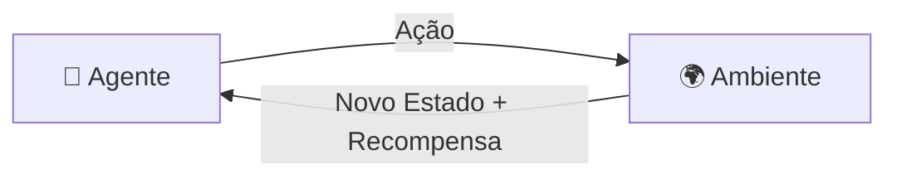

## Resumo

No Aprendizado por Reforço (*Reinforcement Learning* — RL), não existe um conjunto de dados pronto com respostas. Em vez disso, um **agente** aprende **por tentativa e erro**, interagindo com um **ambiente**. A cada ação que ele toma, recebe uma **recompensa** (se foi bom) ou uma **penalidade** (se foi ruim).

O objetivo do agente é descobrir a **estratégia (política)** que **maximiza a recompensa total ao longo do tempo** — e não só a recompensa imediata.

> [!info] Ideia central
> **Agente age → Ambiente responde com um novo estado + recompensa → Agente ajusta sua estratégia → repete milhares/milhões de vezes.**

## Os Componentes do Aprendizado por Reforço

| Componente | O que é | Exemplo (jogo de videogame) |
|---|---|---|
| **Agente** | Quem aprende e toma decisões | O personagem controlado pela IA |
| **Ambiente** | O "mundo" onde o agente atua | A fase do jogo |
| **Estado** | A situação atual do ambiente | Posição do personagem, inimigos, vida |
| **Ação** | O que o agente pode fazer | Pular, andar, atacar |
| **Recompensa** | O retorno (positivo ou negativo) da ação | +10 por moeda, −100 por morrer |
| **Política** | A estratégia aprendida: "no estado X, faça a ação Y" | "Se tem um buraco na frente, pule" |

## Exploração vs. Exploração (*Exploration vs. Exploitation*)

Um dilema central do RL:
- **Explorar (*exploration*)**: testar ações novas para descobrir se existe algo melhor.
- **Aproveitar (*exploitation*)**: repetir o que já sabe que dá uma boa recompensa.

Um bom agente precisa **equilibrar** os dois — se só aproveitar, nunca descobre caminhos melhores; se só explorar, nunca usa o que aprendeu.

## Algoritmos e Técnicas Conhecidas

| Técnica | Ideia |
|---|---|
| **Q-Learning** | Monta uma "tabela" com o valor esperado de cada ação em cada estado |
| **Deep Q-Network (DQN)** | Q-Learning usando redes neurais (jogou Atari melhor que humanos) |
| **Policy Gradient / PPO** | Aprende diretamente a política (muito usado em robótica e em LLMs) |
| **RLHF** (*Reinforcement Learning from Human Feedback*) | Humanos avaliam respostas de um modelo e isso vira a recompensa — usado para alinhar **ChatGPT, Claude** e outros LLMs |

## Vantagens e Desvantagens

| ✅ Vantagens | ❌ Desvantagens |
|---|---|
| **Não precisa de dados rotulados** — aprende com a experiência | Exige **muitas** tentativas (alto custo computacional) |
| Resolve problemas de **decisões em sequência** | Difícil definir uma **boa função de recompensa** |
| Pode descobrir estratégias **melhores que as humanas** | Treinar no mundo real pode ser perigoso/caro → usa-se **simulação** |
| Adapta-se a ambientes dinâmicos | O agente pode "trapacear" a recompensa (*reward hacking*) |

## Exemplo para Associação Mental

**Adestrando um Cachorro** 🐶 Imagine que você quer ensinar seu cachorro a sentar.

- Você **não mostra um manual** com fotos de "cachorro sentado" (isso seria supervisionado).
- Você diz "senta!" e espera. O cachorro tenta várias coisas: late, pula, deita...
- Quando ele finalmente **senta**, ganha um **petisco** (recompensa ✅).
- Quando pula em você, **não ganha nada** ou leva um "não!" (penalidade ❌).
- Depois de várias repetições, ele aprende a **estratégia** que maximiza os petiscos: ouvir "senta" → sentar.

O cachorro é o **agente**, a sua casa é o **ambiente**, e o petisco é a **recompensa**.

No dia a dia, o Aprendizado por Reforço está por trás do **AlphaGo** (que venceu o campeão mundial de Go), de **robôs que aprendem a andar**, de **carros autônomos** decidindo manobras em simuladores, da **otimização de preços dinâmicos** e do ajuste fino (RLHF) que torna **assistentes como ChatGPT e Claude** mais úteis e seguros.

## Na AWS (AI Practitioner)

- **AWS DeepRacer**: carrinho de corrida autônomo (1/18) treinado com **Aprendizado por Reforço** — o exemplo clássico da AWS para RL.
- **Amazon SageMaker RL**: suporte a treinamento de modelos de reforço.
- **RLHF** aparece no contexto de **Amazon Bedrock** e **SageMaker Ground Truth** (avaliação humana de respostas de modelos).

---
Relacionados: [[Aprendizado Supervisionado]] · [[Aprendizado Não Supervisionado]] · [[Diferenças entre os Tipos de Aprendizado]]
