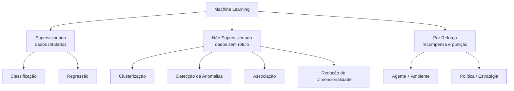

## Resumo

Os algoritmos de [[O que é  Machine Learn|Machine Learning]] se dividem em **três grandes famílias**, de acordo com a forma como aprendem. Esta nota é o **índice** da pasta de ML.

## Notas desta pasta

| Nota | Em uma frase |
|---|---|
| [[Aprendizado Supervisionado]] | Aprende com **dados rotulados** (tem gabarito) para **prever** categorias ou valores. |
| [[Aprendizado Não Supervisionado]] | Aprende com **dados sem rótulo** para **descobrir** grupos e padrões escondidos. |
| [[Aprendizado por Reforço]] | Um **agente** aprende por **tentativa e erro**, guiado por **recompensas**. |
| [[Diferenças entre os Tipos de Aprendizado]] | Tabela comparativa, cenários práticos e tipos intermediários. |

🗺️ **Mapa visual:** [[Tipos de Aprendizado de Machine Learning.canvas]]

## Visão Geral

## Exemplo para Associação Mental

- **Supervisionado** = 📘 estudar com o **gabarito**.
- **Não Supervisionado** = 🧦 organizar a **gaveta de meias** sem ninguém dizer como.
- **Por Reforço** = 🐶 **adestrar um cachorro** com petiscos.
