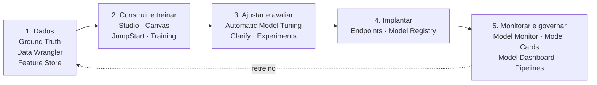

## Resumo

O **Amazon SageMaker AI** é a plataforma **completa e gerenciada** para **construir, treinar, implantar e monitorar modelos de machine learning**. Ele cobre todo o **ciclo de vida de ML**, da preparação dos dados até o monitoramento em produção. Desde dez/2024 o serviço de ML se chama **SageMaker AI**, e "Amazon SageMaker" virou o nome da plataforma unificada de dados, analytics e IA (*SageMaker Unified Studio*).

> [!info] Ideia central
> **Seus dados → seu modelo de ML personalizado → em produção.** Quando nenhum serviço pronto resolve, você usa o SageMaker.
> 🔑 Palavras-chave na prova: "**treinar um modelo próprio**", "**ciclo de vida de ML**", "**MLOps**", "**cientistas de dados**", "**controle total**", "**sem código (Canvas)**".

## Ficha rápida

| Item | Detalhe |
|---|---|
| **Categoria** | Plataforma de ML (ciclo de vida completo) |
| **Entrada** | Seus dados (geralmente no **S3**) |
| **Saída** | Modelo treinado + **endpoint** para inferência |
| **Precisa saber ML?** | Em geral **sim** (cientistas de dados). Exceção: **Canvas** (sem código) |
| **Customização** | **Total**: algoritmo, instâncias, hiperparâmetros, código próprio |
| **Modos de inferência** | Tempo real · Serverless · Assíncrona · Lote (*batch transform*) → [[ML Inference]] |
| **Na prova** | Domínio 1 (1.3) · Domínio 3 · Domínio 4 · ⭐⭐⭐ |
| **Status 2026** | ✅ Disponível · ⚠️ **Clarify, Model Monitor, Ground Truth, Debugger e A2I** sem novos clientes desde 30/07/2026 (continuam valendo na prova) |

## Principais recursos

Organizados por etapa do ciclo de vida de ML (cai muito):

| Etapa | Recurso | Para que serve |
|---|---|---|
| **Dados** | **Ground Truth** ⚠️ | **Rotular dados** com humanos (e ML) para treinar modelos |
| | **Data Wrangler** | **Preparar e transformar dados** visualmente (limpeza, *feature engineering*) |
| | **Feature Store** | **Repositório de features** reutilizáveis entre treino e inferência |
| **Construir** | **Studio** | IDE web para todo o trabalho de ML (notebooks, jobs, pipelines) |
| | **Canvas** | ML **sem código** para analistas de negócio (inclui previsão de séries temporais e AutoML) |
| | **JumpStart** | **Hub de modelos pré-treinados** e FMs para implantar e ajustar com **controle da infraestrutura** |
| | **Training / algoritmos integrados** | Treino gerenciado (XGBoost, k-means, etc.) em instâncias escolhidas por você |
| **Ajustar e avaliar** | **Automatic Model Tuning** | Busca automaticamente os **melhores hiperparâmetros** |
| | **Clarify** ⚠️ | Detecta **viés** nos dados/modelo e **explica** as previsões (explicabilidade) |
| | **Experiments** | Registra e compara execuções de treino |
| | **Debugger** ⚠️ | Depura problemas durante o treino |
| **Implantar** | **Endpoints** | Inferência real-time, serverless, assíncrona ou batch |
| | **Model Registry** | Catálogo de **versões** de modelos aprovadas para produção |
| **Monitorar e governar** | **Model Monitor** ⚠️ | Detecta **desvio** (*drift*) de dados e de qualidade em produção |
| | **Model Cards** | **Documentação** do modelo: uso pretendido, riscos, métricas (transparência) |
| | **Model Dashboard** | Visão central de todos os modelos e alertas |
| | **Pipelines** | Automatiza o fluxo de ML (**MLOps**, CI/CD de modelos) |
| | **Role Manager** ⚠️ | Cria permissões de IAM para personas de ML |

⚠️ = em manutenção desde 2026 (sem novos clientes), mas **cobrado na prova**.

> [!tip] Aprofundamento
> Cada recurso explicado em detalhe, pares que confundem e teste rápido: [[SageMaker - Recursos em Detalhe]]
> Por grupo: [[SageMaker - Data Tools]] · [[SageMaker - Models and Humans]]
> Simulado com 20 questões: [[SageMaker - Formulário de Respostas]] · Índice da pasta: [[Índice - SageMaker]]

## Casos de uso

| Cenário | Por que SageMaker |
|---|---|
| Modelo de **churn** ou crédito com dados próprios | Precisa treinar com dados específicos da empresa |
| **MLOps** com várias equipes | Pipelines, Registry e Monitor para repetibilidade |
| Analista de negócio sem saber programar | **Canvas** |
| Implantar um modelo open source **controlando as instâncias** | **JumpStart** |
| Detectar **viés** e explicar decisões (regulação) | **Clarify** + **Model Cards** |

## Não confunda

| Serviço | Diferença |
|---|---|
| [[Amazon Bedrock]] | Bedrock = **usar FMs prontos por API, serverless**. SageMaker = **construir/treinar** seus modelos com mais **controle** |
| Serviços de IA prontos ([[Amazon Comprehend]], [[Amazon Rekognition]]…) | Prontos para tarefas comuns, **sem treino**. O SageMaker serve para o que eles não cobrem |
| [[Amazon Augmented AI]] | Revisão humana de **previsões**. O Ground Truth rotula dados **para treino** |
| [[Amazon Q]] Developer | Assistente de **código**. Não treina modelos |

> [!warning] Pegadinhas de prova
> - "Detectar **viés** e **explicar** previsões" → **SageMaker Clarify**.
> - "Modelo perdendo qualidade em produção (**drift**)" → **SageMaker Model Monitor**.
> - "**Rotular** dados para treino" → **SageMaker Ground Truth**.
> - "**Documentar** o modelo para auditoria/transparência" → **SageMaker Model Cards**.
> - "**Preparar dados** sem código" → **Data Wrangler** · "**ML sem código**" → **Canvas**.
> - "Reutilizar **features** entre equipes" → **Feature Store**.
> - "Encontrar os **melhores hiperparâmetros**" → **Automatic Model Tuning**.

## Exemplo para Associação Mental

**A Cozinha Industrial.** Os serviços de IA prontos são **comida congelada**: esquenta e come. O Bedrock é o **restaurante**: você pede o prato pronto (FM). O **SageMaker é a cozinha industrial completa**: tem a **despensa** (Feature Store), a **bancada de preparo** (Data Wrangler), o **fogão** (Training), o **provador** (Clarify), o **caderno de receitas** (Model Registry/Cards) e o **fiscal de qualidade** (Model Monitor). Dá trabalho, mas você cozinha **exatamente** o que quer.

## 📝 Meu entendimento

> _Escreva aqui, com suas palavras, o que entendeu sobre o SageMaker._

---
Resumo: [[Resumo]] · Anterior: [[Amazon Augmented AI]] · Próximo: [[Amazon Bedrock]]

Fontes: [Amazon SageMaker AI](https://aws.amazon.com/pt/sagemaker-ai/) · [Serviços em manutenção (AWS)](https://docs.aws.amazon.com/general/latest/gr/maintenance_services.html)
