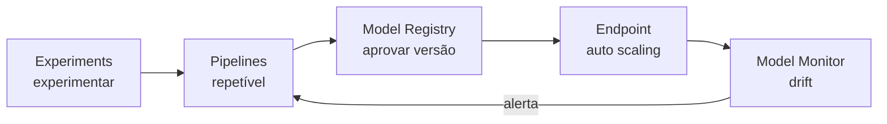

## Resumo

Cobre a **Tarefa 1.3 do Domínio 1** ([[02 - Domínio 1 - Fundamentos de IA e ML]]) do ponto de vista do SageMaker: **etapas do pipeline de ML**, **de onde vêm os modelos**, **API gerenciada x auto-hospedada**, **algoritmos integrados por tipo de problema**, **MLOps** e **métricas**.

> [!info] Ideia central
> Um projeto de ML é um **ciclo**, não uma linha reta: dados → treino → avaliação → deploy → monitoramento → **retreino**. **MLOps** é fazer esse ciclo de forma **repetível, escalável e automatizada**, e o SageMaker tem um recurso para cada etapa.

---

## 1. Pipeline de ML → recurso do SageMaker

| # | Etapa | O que acontece | Recurso AWS |
|---|---|---|---|
| 1 | **Coleta de dados** | Juntar dados de várias fontes | **S3**, Glue, AWS Data Exchange |
| 2 | **Rotulagem** (se supervisionado) | Humanos marcam o rótulo correto | **Ground Truth** → [[SageMaker - Models and Humans]] |
| 3 | **Análise exploratória (EDA)** | Entender distribuições, correlações, problemas | **Studio** (notebooks), **Data Wrangler** |
| 4 | **Pré-processamento** | Limpar nulos, outliers, formatos | **Data Wrangler**, Processing → [[SageMaker - Data Tools]] |
| 5 | **Engenharia de features** | Criar/transformar variáveis | Data Wrangler, **Feature Store** |
| 6 | **Treinamento** | Algoritmo aprende com os dados | **Training Jobs**, algoritmos integrados, JumpStart, HyperPod |
| 7 | **Ajuste de hiperparâmetros** | Buscar a melhor configuração | **Automatic Model Tuning** |
| 8 | **Avaliação** | Medir métricas, viés, explicabilidade | Métricas do Training, **Clarify**, **Experiments** |
| 9 | **Registro e aprovação** | Versionar e aprovar para produção | **Model Registry** |
| 10 | **Implantação** | Disponibilizar para uso | **Endpoints**: real-time, serverless, async, batch → [[ML Inference]] |
| 11 | **Monitoramento** | Detectar drift e queda de qualidade | **Model Monitor**, CloudWatch |
| 12 | **Retreino** | Atualizar com dados novos | **Pipelines** (automatiza o ciclo) |

> [!warning] Na prova
> A pergunta típica dá a **etapa** e pede o **serviço**: "engenharia de features reutilizáveis" → Feature Store; "monitorar em produção" → Model Monitor; "pré-processar" → Data Wrangler.

---

## 2. De onde vêm os modelos

| Origem | Como no SageMaker | Quando faz sentido |
|---|---|---|
| **Pré-treinado open source** | **JumpStart** (Llama, Mistral, Falcon, Stable Diffusion, modelos de visão/NLP) | Tarefa comum; economiza tempo e custo; pode fazer **fine-tuning** |
| **Pré-treinado comercial** | **AWS Marketplace** (modelos de terceiros), JumpStart (modelos proprietários) | Precisa de um modelo especializado de fornecedor |
| **Treinado sob medida** | **Training Jobs** com algoritmo integrado, framework (PyTorch/TensorFlow) ou container próprio | Problema **específico** da empresa, com **dados próprios** |
| **Sem código** | **Canvas** (AutoML) | Analista de negócio, sem cientista de dados |

> [!tip] Regra de custo
> **Reaproveitar** (pré-treinado / transfer learning) é quase sempre **mais barato e rápido** que treinar do zero.

---

## 3. Colocar em produção: API gerenciada x auto-hospedada

| | **API gerenciada** | **API auto-hospedada** (*self-hosted*) |
|---|---|---|
| **Exemplos** | **Amazon Bedrock**, serviços de IA prontos, **SageMaker Endpoints** | Modelo rodando em **EC2**, **EKS/ECS**, ou on-premises |
| **Quem cuida da infraestrutura** | A **AWS** (escala, patches, disponibilidade) | **Você** (servidores, escala, segurança, atualizações) |
| **Controle** | Menor | **Total** |
| **Esforço operacional** | **Baixo** | **Alto** |
| **Quando** | Quer focar no negócio, pouca equipe de infraestrutura | Requisitos muito específicos de hardware, rede ou software |

> [!note] Onde fica o SageMaker
> O SageMaker é o **meio-termo**: você **escolhe** a instância e o modelo, mas a AWS **gerencia** o endpoint (subir, escalar com *auto scaling*, trocar versões). O Bedrock é ainda mais gerenciado (**serverless**, sem escolher instância).

---

## 4. Algoritmos integrados por tipo de problema

A prova não pede detalhes técnicos, mas ajuda a ligar **problema → técnica → algoritmo**.

| Problema | Técnica | Algoritmos integrados do SageMaker |
|---|---|---|
| Prever um **número** (preço, demanda) | **Regressão** (supervisionado) | **Linear Learner**, **XGBoost** |
| Prever uma **categoria** (spam, churn, fraude) | **Classificação** (supervisionado) | **XGBoost**, Linear Learner, k-NN |
| **Agrupar** clientes sem rótulo | **Clusterização** (não supervisionado) | **k-means** |
| Reduzir nº de variáveis | Redução de dimensionalidade (não supervisionado) | **PCA** |
| Detectar **anomalias** | Não supervisionado | **Random Cut Forest** |
| **Séries temporais** (previsão) | Supervisionado | **DeepAR** |
| **Recomendação** | Supervisionado | **Factorization Machines** |
| Classificar **imagens** / detectar objetos | Visão computacional (deep learning) | Image Classification, Object Detection, Semantic Segmentation |
| Classificar **texto** / embeddings de palavras | NLP | **BlazingText** |
| **Tópicos** em documentos | NLP, não supervisionado | LDA, Neural Topic Model |
| Tradução / resumo | NLP (*sequence-to-sequence*) | Seq2Seq |

> [!tip] Para decorar
> **XGBoost** = "canivete suíço" para dados **tabulares** (regressão e classificação). **k-means** = **agrupar**. **Random Cut Forest** = **anomalia**. **DeepAR** = **série temporal**.

---

## 5. MLOps: cada conceito → recurso do SageMaker

O guia lista conceitos de MLOps. Saiba o que cada um significa e qual recurso ajuda.

| Conceito do guia | O que significa | Recurso do SageMaker |
|---|---|---|
| **Experimentação** | Testar várias versões de dados, algoritmos e parâmetros e **comparar** | **Experiments** (com **MLflow gerenciado**), Studio |
| **Processos repetíveis** | Rodar o mesmo fluxo e obter o mesmo resultado, sem passos manuais | **Pipelines** |
| **Sistemas escaláveis** | Aguentar mais dados e mais tráfego | Training distribuído, **auto scaling** de endpoints, HyperPod |
| **Dívida técnica** | "Gambiarras" acumuladas: scripts soltos, features duplicadas, nada versionado | Feature Store, Model Registry, Pipelines (padronizam) |
| **Prontidão para produção** | Modelo testado, aprovado, documentado e seguro | **Model Registry** (aprovação), **Model Cards**, Shadow testing, Inference Recommender |
| **Monitoramento do modelo** | Acompanhar qualidade e drift em produção | **Model Monitor**, CloudWatch, Model Dashboard |
| **Retreino do modelo** | Atualizar o modelo quando os dados mudam | **Pipelines** acionado por alerta do Model Monitor |

> [!note] Quando retreinar?
> Quando o **Model Monitor** detecta **data drift** (os dados de entrada mudaram) ou **concept drift** (a relação entre entrada e resultado mudou, ex.: comportamento de compra após uma crise) e a **qualidade cai**.

---

## 6. Métricas: técnicas x de negócio

| Tipo | Métricas | Onde aparece no SageMaker |
|---|---|---|
| **Técnicas (classificação)** | Acurácia, precisão, recall, **F1**, **AUC-ROC**, matriz de confusão | Logs do Training Job, Autopilot/Canvas (relatório do modelo), Experiments |
| **Técnicas (regressão)** | **MAE**, **RMSE**, **R²** | Idem |
| **De negócio** | **ROI**, **custo por usuário**, custo de desenvolvimento, **feedback de clientes**, conversão | Medidas **fora** do SageMaker (BI, CloudWatch, pesquisas). O modelo pode ser ótimo tecnicamente e ruim para o negócio |

> [!warning] Pegadinhas de prova
> - Classes **desbalanceadas** (ex.: 1% de fraude) → **acurácia engana**. Use **precisão, recall, F1 ou AUC**.
> - "O modelo tem ótima acurácia mas **não trouxe retorno**" → olhar **métricas de negócio** (ROI).
> - **Automatic Model Tuning** otimiza **uma métrica técnica** que você escolhe (ex.: maximizar AUC).

## 📝 Meu entendimento

> _Desenhe de memória o ciclo de ML e escreva o recurso do SageMaker de cada etapa._

---
Voltar: [[Índice - SageMaker]] · Relacionadas: [[SageMaker - Data Tools]] · [[SageMaker - Models and Humans]] · [[ML Inference]] · [[Aprendizado Supervisionado]]

Fontes: [SageMaker AI – algoritmos integrados](https://docs.aws.amazon.com/sagemaker/latest/dg/algos.html) · [MLOps com SageMaker](https://aws.amazon.com/sagemaker-ai/mlops/)
