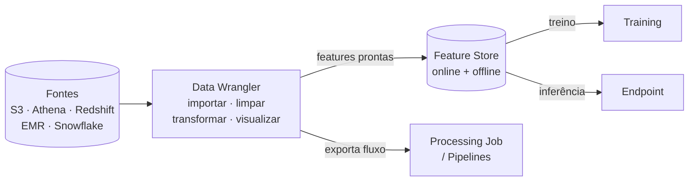

## Resumo

As **Data Tools** do SageMaker cuidam da **primeira etapa do ciclo de ML: os dados**. Antes de treinar qualquer modelo, os dados precisam ser **coletados, limpos, transformados e organizados em features**. Na prova, essas ferramentas aparecem em perguntas sobre **preparação de dados** e **feature engineering**.

> [!info] Ideia central
> **Dados ruins = modelo ruim** (*garbage in, garbage out*).
> - **Data Wrangler** → **prepara** os dados (limpa, transforma, visualiza).
> - **Feature Store** → **guarda e compartilha** as features prontas.
> - **Processing** → **roda scripts** de processamento em escala.
> - **Canvas (Data Prep)** → mesma preparação, **sem código**, para analistas.

> [!note] Conceito: o que é uma *feature*?
> **Feature** = uma **variável de entrada** do modelo (uma coluna). Ex.: idade, renda, "nº de compras nos últimos 30 dias".
> **Feature engineering** = criar ou transformar features para o modelo aprender melhor (ex.: transformar "data de nascimento" em "idade"; texto em categorias numéricas).

---

## 1. SageMaker Data Wrangler

**Para que serve:** **preparar dados tabulares e de imagem** para ML de forma **visual**, com pouco ou nenhum código. Reduz o tempo de preparação de semanas para minutos.

### O que ele faz (passo a passo)

| Etapa | O que acontece |
|---|---|
| **1. Importar** | Conecta em **S3, Athena, Redshift, EMR, Snowflake, Databricks** etc. Aceita **consulta SQL** na importação |
| **2. Visualizar** | Gráficos e histogramas para entender os dados |
| **3. Data Quality and Insights Report** | Relatório automático: valores **ausentes**, **duplicados**, **outliers**, desbalanceamento e vazamento de alvo (*target leakage*) |
| **4. Transformar** | **300+ transformações prontas**: preencher nulos, normalizar, *one-hot encoding*, remover colunas, juntar tabelas. Também aceita código próprio (Python, PySpark, SQL) |
| **5. Quick Model** | Treina um **modelo rápido** para estimar se os dados estão bons e **quais features importam** |
| **6. Exportar** | Envia para o **Feature Store**, gera **Processing Job**, **Pipeline** ou notebook |

- Hoje fica disponível **dentro do SageMaker Canvas** (Canvas Data Prep), e também aceita **linguagem natural** ("remova as linhas com idade nula").

### Casos de uso
- Limpar uma base de clientes com **valores faltando** e **colunas em formatos diferentes** antes de treinar um modelo de churn.
- Juntar dados de vendas (Redshift) com dados de clientes (S3) e criar features novas.
- Descobrir, antes de treinar, que **90% dos exemplos são de uma única classe** (desbalanceamento).

> [!warning] Na prova
> "**Preparar / limpar / transformar dados** para ML, **visualmente**, **sem muito código**" → **Data Wrangler**.

---

## 2. SageMaker Feature Store

**Para que serve:** **repositório central** para **armazenar, compartilhar e reutilizar features** entre equipes e modelos, garantindo que **treino e inferência usem exatamente a mesma feature**.

### Como funciona

| Componente | Para que serve |
|---|---|
| **Feature Group** | "Tabela" de features (ex.: grupo `cliente` com idade, renda, gasto médio) |
| **Online Store** | **Baixa latência** (milissegundos) → usado na **inferência em tempo real** (traz só o valor mais recente) |
| **Offline Store** | **Histórico completo** no **S3** → usado no **treino** e em consultas com **Athena** |
| **Ingestão** | Em **streaming** (tempo real) ou em **lote** (batch). O Data Wrangler publica direto aqui |
| **Catálogo** | Features **pesquisáveis** no SageMaker Studio, com metadados e versão |

### O problema que ele resolve
Sem Feature Store, cada equipe calcula "gasto médio do cliente" **do seu jeito**. Resultado: **trabalho repetido** e **inconsistência** entre o valor usado no treino e o usado em produção (*training-serving skew*).

### Casos de uso
- Feature "média de compras em 30 dias" usada por modelos de **fraude**, **churn** e **recomendação**.
- Detecção de fraude em **tempo real** que precisa buscar as features do cliente em milissegundos (online store).
- Recriar exatamente os dados de uma data passada para **retreinar ou auditar** (offline store, *time travel*).

> [!warning] Na prova
> "**Reutilizar features** entre equipes", "**fonte única** de features", "**consistência** entre treino e inferência" → **Feature Store**.

---

## 3. SageMaker Processing

**Para que serve:** rodar **jobs de processamento de dados** (pré-processamento, pós-processamento, avaliação de modelo) em **infraestrutura gerenciada** com seus próprios scripts.

- Suporta **scikit-learn, Spark, PyTorch, TensorFlow** ou container próprio.
- O SageMaker **sobe as instâncias, roda e desliga** (paga só pelo tempo).
- O Data Wrangler e o Clarify **usam Processing Jobs por trás**.

**Caso de uso:** script Python pesado de limpeza que roda sobre **terabytes no S3** toda semana.

> [!warning] Na prova
> Menos cobrado. "Rodar **scripts próprios** de processamento sem gerenciar servidores" → **Processing**.

---

## 4. SageMaker Canvas (Data Prep)

**Para que serve:** a mesma preparação de dados do Data Wrangler, **sem código**, para **analistas de negócio**, já integrada ao treino no-code do Canvas.

**Caso de uso:** analista importa uma planilha, remove colunas inúteis com cliques e já treina um modelo de previsão.

---

## Comparação das Data Tools

| Ferramenta | Verbo-chave | Quem usa | Entrada → Saída |
|---|---|---|---|
| **Data Wrangler** | **Preparar** / transformar | Cientista de dados | Dados brutos → dados limpos e features |
| **Feature Store** | **Guardar** / compartilhar | Times de ML, MLOps | Features → features reutilizáveis (online/offline) |
| **Processing** | **Executar** scripts | Engenheiro de ML | Script + dados → dados processados |
| **Canvas Data Prep** | Preparar **sem código** | Analista de negócio | Planilha → dados prontos para treino |
| **Ground Truth** ¹ | **Rotular** | Humanos | Dados sem rótulo → dados rotulados |

¹ O Ground Truth também mexe com dados, mas depende de **humanos**. Por isso está em [[SageMaker - Models and Humans]].

## Não confunda (fora do SageMaker)

| Serviço | Diferença |
|---|---|
| **AWS Glue** | **ETL** geral de dados (não é específico de ML) e catálogo de dados |
| **AWS Glue DataBrew** | Preparação visual de dados para **analytics em geral**. Data Wrangler é **focado em ML** |
| **Amazon S3** | Onde os dados **ficam guardados**. Não prepara nem versiona features |
| **Amazon Athena** | **Consulta SQL** sobre dados no S3 (pode consultar a offline store) |

> [!warning] Pegadinhas de prova
> - Enunciado fala em **ML** + preparar dados → **Data Wrangler** (não Glue DataBrew).
> - Enunciado fala em **"features" compartilhadas** → **Feature Store** (não S3).
> - "**Relatório de qualidade** dos dados antes de treinar" → Data Wrangler (*Data Quality and Insights Report*).
> - "Detectar **viés nos dados** antes de treinar" → **Clarify** (não Data Wrangler) → [[SageMaker - Models and Humans]].

## Exemplo para Associação Mental

**A cozinha antes do prato.** O **Data Wrangler** é a **bancada de preparo**: lavar, descascar e cortar os ingredientes. O **Feature Store** é a **despensa organizada com etiquetas**: os ingredientes já preparados ficam lá e **qualquer cozinheiro** pega o mesmo ingrediente, do mesmo jeito. O **Processing** é o **ajudante de cozinha** que faz o trabalho pesado quando o volume é enorme.

## 📝 Meu entendimento

> _Explique com suas palavras a diferença entre Data Wrangler e Feature Store._

---
Voltar: [[Índice - SageMaker]] · Próximo: [[SageMaker - Models and Humans]] · Relacionadas: [[Amazon SageMaker]] · [[SageMaker - Recursos em Detalhe]]

Fontes: [SageMaker Data Wrangler](https://aws.amazon.com/sagemaker-ai/data-wrangler/) · [SageMaker Feature Store](https://aws.amazon.com/sagemaker-ai/feature-store/) · [Documentação do SageMaker AI](https://docs.aws.amazon.com/sagemaker/latest/dg/whatis.html)
