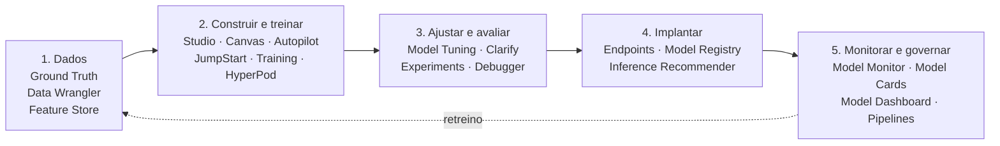

## Resumo

Ponto de partida para estudar o **Amazon SageMaker AI** no AI Practitioner. Aqui ficam todas as notas do SageMaker, na ordem recomendada de estudo.

> [!info] Ideia central
> **SageMaker** = plataforma **completa** para **construir, treinar, implantar e monitorar** seus próprios modelos de ML. Use quando nenhum serviço pronto (Comprehend, Rekognition…) ou o Bedrock resolver.

## Ordem de estudo

| # | Nota | Para que serve |
|---|---|---|
| 1 | [[Amazon SageMaker]] | Visão geral, ficha rápida, mapa do ciclo de vida e pegadinhas |
| 2 | [[SageMaker - Recursos em Detalhe]] | Cada recurso explicado, pares que confundem, mapa por persona |
| 3 | [[SageMaker - Data Tools]] | Data Wrangler, Feature Store, Processing e Canvas Data Prep: preparar e organizar dados |
| 4 | [[SageMaker - Models and Humans]] | Clarify (avaliação, explicabilidade, viés), Ground Truth (rotulagem, RLHF) e A2I |
| 5 | [[ML Inference]] | Modos de inferência (real-time, serverless, async, batch) |
| 6 | [[SageMaker - Formulário de Respostas]] | Simulado com 20 questões para responder e se corrigir |

## Mapa do ciclo de vida

## Relacionadas
- [[Amazon Bedrock]] · [[Índice - Bedrock]] (comparação Bedrock x SageMaker x JumpStart)
- [[Amazon Augmented AI]] (não confundir com Ground Truth)
- [[Resumo]] dos serviços de IA

## Checklist

- [ ] Li a visão geral
- [ ] Sei o que cada recurso faz sem olhar
- [ ] Sei os pares que confundem
- [ ] Fiz o formulário e acertei 16+ de 20
